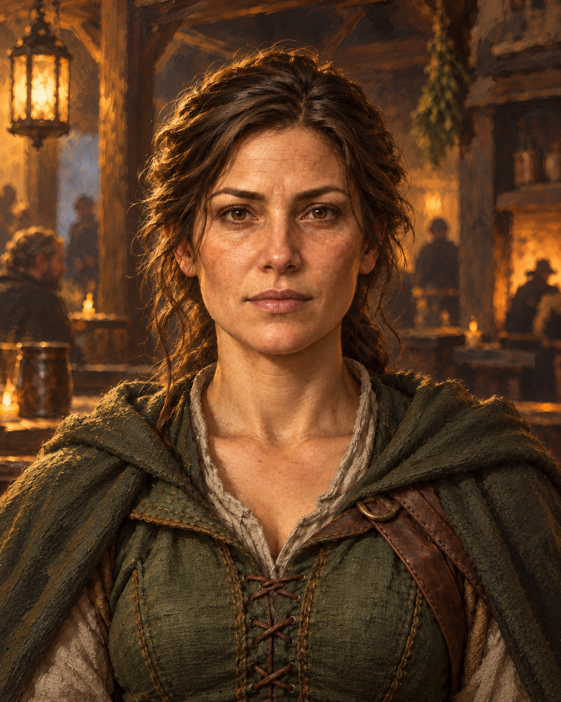

# Asset-Produktion

Der maschinenlesbare Katalog [asset-catalog.json](asset-catalog.json) enthält für jede
Datei den vollständigen Prompt, Maße, Alpha-/Graustufenanforderung, Registrierung und Größenbudget.
Er wird mit `python3 scripts/produce_asset_prompts` reproduzierbar aus `scripts/asset_contract.py` erzeugt.
Keine Führungsmaske wird als fertiges gemaltes Spiel-Asset installiert.

## Gemalte Stilreferenz

Für dieses Projekt mit dem OpenAI-Bildgenerator ohne Bildvorlage erzeugt, fiktive erwachsene Figur.
Diese Einzelillustration ist eine Stilreferenz und erfüllt keinen Ebenenvertrag: unter anderem
weichen Bildmaße und Augenregistrierung vom Produktionsstandard ab. Sie ist kein mitgeliefertes
Laufzeit-Asset und wird nicht als eine der 82 fertigen Ebenen gezählt.

## Gemeinsamer Stil und Abnahme

Semi-realistische gemalte Fantasy, natürliche erwachsene Anatomie, Licht von oben links,
warme Kerzenbeleuchtung innen, natürliche Materialfarben und gedämpfte Kontraste, keine Comic-Optik.
Tönbare Teile neutral grau; Alpha außen vollständig transparent. Keine Schrift oder Wasserzeichen.
Augenlinie und Fußlinie sind Teil der Registrierung, nicht bloß ein späterer Bildschirmzuschnitt.
Graue Ebenen werden zur Laufzeit mit Haut-, Haar- und Stofffarben multipliziert.

Eine Illustration darf erst nach Sichtprüfung, `scripts/check_assets` und Herkunftseintrag in
`CREDITS.md` nach `app/src/main/assets` übernommen werden. Pro Bild ist eine gleichnamige
`.json`-Datei (z. B. `female_0.webp.json`) mit den `registration`-Werten aus dem Katalog und
`source` sowie `license` erforderlich. Metadaten prüfen die erklärte Registrierung; die tatsächliche
Anatomie und Motivposition muss zusätzlich ein Mensch prüfen. Das Werkzeug erkennt kein Gesicht.

Figuren: zwei Basen `female` und `male`, je sechs Posen (`standing`, `sitting`, vier Gehphasen).
Alle Teile derselben Pose liegen deckungsgleich auf 768 × 1536; Mittelachse x=384, Füße y=1480.
Schatten ist eine eigene Ebene. Divers verwendet die gewählte prozedurale Basis, sofern keine eigene Grafik vorliegt.

Szenen: ein Tagesbild pro Ort, Tageszeiten per Farbgrading. Perspektive und Boden kommen aus
`layout.json`, 12 × 9 Zellen bleiben unverändert. Das Tagesbild enthält Wand und Boden;
Vordergrundmöbel liegen in neun transparenten Zeilenebenen und werden nach Tiefe mit Figuren
verschachtelt. Nicht walkable Zellen bleiben auch bei fehlenden Bildern gesperrt.

Budgetziele: Porträts insgesamt 6–9 MiB, Figuren abhängig von Variantenzahl separat messen,
Szenen nach Kompression separat messen. Die 256-KiB-Grenze pro Personenebene ist eine Obergrenze,
kein APK-Gesamtbudget. Vor Freigabe den tatsächlichen APK-Zuwachs dokumentieren.

## Vollständige Dateiliste

Jede folgende Zeile ist ein Produktionsauftrag. Der vollständige Prompt steht unter demselben Pfad
im JSON-Katalog; der gemeinsame Stil und die Registrierung oben gelten unverändert.

| Datei | Maße | Alpha | Tönbar | Motiv / Pose |
|---|---|---|---|---|
| `portraits/base/female_0.webp` | 1024×1280 | ja | ja | female adult face shape oval; skin, ears and neck only, no features, hair or garment. |
| `portraits/base/female_1.webp` | 1024×1280 | ja | ja | female adult face shape round; skin, ears and neck only, no features, hair or garment. |
| `portraits/base/female_2.webp` | 1024×1280 | ja | ja | female adult face shape angular; skin, ears and neck only, no features, hair or garment. |
| `portraits/base/female_3.webp` | 1024×1280 | ja | ja | female adult face shape heart; skin, ears and neck only, no features, hair or garment. |
| `portraits/base/female_4.webp` | 1024×1280 | ja | ja | female adult face shape narrow; skin, ears and neck only, no features, hair or garment. |
| `portraits/base/male_0.webp` | 1024×1280 | ja | ja | male adult face shape oval; skin, ears and neck only, no features, hair or garment. |
| `portraits/base/male_1.webp` | 1024×1280 | ja | ja | male adult face shape round; skin, ears and neck only, no features, hair or garment. |
| `portraits/base/male_2.webp` | 1024×1280 | ja | ja | male adult face shape angular; skin, ears and neck only, no features, hair or garment. |
| `portraits/base/male_3.webp` | 1024×1280 | ja | ja | male adult face shape heart; skin, ears and neck only, no features, hair or garment. |
| `portraits/base/male_4.webp` | 1024×1280 | ja | ja | male adult face shape narrow; skin, ears and neck only, no features, hair or garment. |
| `portraits/eyes/0.webp` | 1024×1280 | ja | nein | Eye shape almond; eyelids and sclera only; iris area transparent. |
| `portraits/eyes/1.webp` | 1024×1280 | ja | nein | Eye shape round; eyelids and sclera only; iris area transparent. |
| `portraits/eyes/2.webp` | 1024×1280 | ja | nein | Eye shape narrow; eyelids and sclera only; iris area transparent. |
| `portraits/eyes/3.webp` | 1024×1280 | ja | nein | Eye shape slanted; eyelids and sclera only; iris area transparent. |
| `portraits/eyes/iris_mask.webp` | 1024×1280 | ja | ja | Iris pair, pupil, reflections only; centered at x=417 and x=607, y=560. |
| `portraits/brows/0.webp` | 1024×1280 | ja | ja | Eyebrow pair: straight. |
| `portraits/brows/1.webp` | 1024×1280 | ja | ja | Eyebrow pair: arched. |
| `portraits/brows/2.webp` | 1024×1280 | ja | ja | Eyebrow pair: bushy. |
| `portraits/brows/3.webp` | 1024×1280 | ja | ja | Eyebrow pair: fine. |
| `portraits/nose/0.webp` | 1024×1280 | ja | nein | Nose: straight, natural skin shading at the shared registration. |
| `portraits/nose/1.webp` | 1024×1280 | ja | nein | Nose: aquiline, natural skin shading at the shared registration. |
| `portraits/nose/2.webp` | 1024×1280 | ja | nein | Nose: upturned, natural skin shading at the shared registration. |
| `portraits/nose/3.webp` | 1024×1280 | ja | nein | Nose: broad, natural skin shading at the shared registration. |
| `portraits/mouth/0.webp` | 1024×1280 | ja | nein | Mouth expression: calm. |
| `portraits/mouth/1.webp` | 1024×1280 | ja | nein | Mouth expression: smiling. |
| `portraits/mouth/2.webp` | 1024×1280 | ja | nein | Mouth expression: serious. |
| `portraits/mouth/3.webp` | 1024×1280 | ja | nein | Mouth expression: determined. |
| `portraits/hair_back/0.webp` | 1024×1280 | ja | ja | Back hair only: short; no face or front locks. |
| `portraits/hair_back/1.webp` | 1024×1280 | ja | ja | Back hair only: parted; no face or front locks. |
| `portraits/hair_back/2.webp` | 1024×1280 | ja | ja | Back hair only: long loose; no face or front locks. |
| `portraits/hair_back/3.webp` | 1024×1280 | ja | ja | Back hair only: ponytail; no face or front locks. |
| `portraits/hair_back/4.webp` | 1024×1280 | ja | ja | Back hair only: bun; no face or front locks. |
| `portraits/hair_back/5.webp` | 1024×1280 | ja | ja | Back hair only: braided; no face or front locks. |
| `portraits/hair_back/6.webp` | 1024×1280 | ja | ja | Back hair only: wild; no face or front locks. |
| `portraits/hair_back/7.webp` | 1024×1280 | ja | ja | Back hair only: shaved; no face or front locks. |
| `portraits/hair_front/0_0.webp` | 1024×1280 | ja | ja | Front hair only: style short, texture straight. |
| `portraits/hair_front/0_1.webp` | 1024×1280 | ja | ja | Front hair only: style short, texture wavy. |
| `portraits/hair_front/0_2.webp` | 1024×1280 | ja | ja | Front hair only: style short, texture curly. |
| `portraits/hair_front/1_0.webp` | 1024×1280 | ja | ja | Front hair only: style parted, texture straight. |
| `portraits/hair_front/1_1.webp` | 1024×1280 | ja | ja | Front hair only: style parted, texture wavy. |
| `portraits/hair_front/1_2.webp` | 1024×1280 | ja | ja | Front hair only: style parted, texture curly. |
| `portraits/hair_front/2_0.webp` | 1024×1280 | ja | ja | Front hair only: style long loose, texture straight. |
| `portraits/hair_front/2_1.webp` | 1024×1280 | ja | ja | Front hair only: style long loose, texture wavy. |
| `portraits/hair_front/2_2.webp` | 1024×1280 | ja | ja | Front hair only: style long loose, texture curly. |
| `portraits/hair_front/3_0.webp` | 1024×1280 | ja | ja | Front hair only: style ponytail, texture straight. |
| `portraits/hair_front/3_1.webp` | 1024×1280 | ja | ja | Front hair only: style ponytail, texture wavy. |
| `portraits/hair_front/3_2.webp` | 1024×1280 | ja | ja | Front hair only: style ponytail, texture curly. |
| `portraits/hair_front/4_0.webp` | 1024×1280 | ja | ja | Front hair only: style bun, texture straight. |
| `portraits/hair_front/4_1.webp` | 1024×1280 | ja | ja | Front hair only: style bun, texture wavy. |
| `portraits/hair_front/4_2.webp` | 1024×1280 | ja | ja | Front hair only: style bun, texture curly. |
| `portraits/hair_front/5_0.webp` | 1024×1280 | ja | ja | Front hair only: style braided, texture straight. |
| `portraits/hair_front/5_1.webp` | 1024×1280 | ja | ja | Front hair only: style braided, texture wavy. |
| `portraits/hair_front/5_2.webp` | 1024×1280 | ja | ja | Front hair only: style braided, texture curly. |
| `portraits/hair_front/6_0.webp` | 1024×1280 | ja | ja | Front hair only: style wild, texture straight. |
| `portraits/hair_front/6_1.webp` | 1024×1280 | ja | ja | Front hair only: style wild, texture wavy. |
| `portraits/hair_front/6_2.webp` | 1024×1280 | ja | ja | Front hair only: style wild, texture curly. |
| `portraits/hair_front/7_0.webp` | 1024×1280 | ja | ja | Front hair only: style shaved, texture straight. |
| `portraits/hair_front/7_1.webp` | 1024×1280 | ja | ja | Front hair only: style shaved, texture wavy. |
| `portraits/hair_front/7_2.webp` | 1024×1280 | ja | ja | Front hair only: style shaved, texture curly. |
| `portraits/beard/1.webp` | 1024×1280 | ja | ja | Beard only: stubble. |
| `portraits/beard/2.webp` | 1024×1280 | ja | ja | Beard only: goatee. |
| `portraits/beard/3.webp` | 1024×1280 | ja | ja | Beard only: full beard. |
| `portraits/beard/4.webp` | 1024×1280 | ja | ja | Beard only: long beard. |
| `portraits/marks/scar_1.webp` | 1024×1280 | ja | nein | Healed adult scar: cheek. |
| `portraits/marks/scar_2.webp` | 1024×1280 | ja | nein | Healed adult scar: over eye. |
| `portraits/marks/scar_3.webp` | 1024×1280 | ja | nein | Healed adult scar: forehead. |
| `portraits/marks/scar_4.webp` | 1024×1280 | ja | nein | Healed adult scar: chin. |
| `portraits/marks/tattoo_1.webp` | 1024×1280 | ja | nein | Tattoo: tribal lines. |
| `portraits/marks/tattoo_2.webp` | 1024×1280 | ja | nein | Tattoo: elven vine. |
| `portraits/marks/tattoo_3.webp` | 1024×1280 | ja | nein | Tattoo: wall sigil. |
| `portraits/outfit/0.webp` | 1024×1280 | ja | ja | Garment only: linen tunic. |
| `portraits/outfit/1.webp` | 1024×1280 | ja | ja | Garment only: leather doublet. |
| `portraits/outfit/2.webp` | 1024×1280 | ja | ja | Garment only: travel dress. |
| `portraits/outfit/3.webp` | 1024×1280 | ja | ja | Garment only: gambeson. |
| `portraits/outfit/4.webp` | 1024×1280 | ja | ja | Garment only: noble robe. |
| `portraits/armor/1.webp` | 1024×1280 | ja | nein | Armor only, material leather; no garment, head or body. |
| `portraits/armor/2.webp` | 1024×1280 | ja | nein | Armor only, material chainmail; no garment, head or body. |
| `portraits/armor/3.webp` | 1024×1280 | ja | nein | Armor only, material scale; no garment, head or body. |
| `portraits/armor/4.webp` | 1024×1280 | ja | nein | Armor only, material plate; no garment, head or body. |
| `portraits/cloak/1.webp` | 1024×1280 | ja | ja | Cloak only: wool; transparent center where face and garment remain visible. |
| `portraits/cloak/2.webp` | 1024×1280 | ja | ja | Cloak only: fur; transparent center where face and garment remain visible. |
| `portraits/cloak/3.webp` | 1024×1280 | ja | ja | Cloak only: elven hood; transparent center where face and garment remain visible. |
| `figures/female/standing/body/0.webp` | 768×1536 | ja | ja | Adult female, standing pose; front camera, same scale across all frames. Body build 0: slim, athletic, strong, stocky respectively; plain neutral underlayer; no hair or equipment. |
| `figures/female/standing/body/1.webp` | 768×1536 | ja | ja | Adult female, standing pose; front camera, same scale across all frames. Body build 1: slim, athletic, strong, stocky respectively; plain neutral underlayer; no hair or equipment. |
| `figures/female/standing/body/2.webp` | 768×1536 | ja | ja | Adult female, standing pose; front camera, same scale across all frames. Body build 2: slim, athletic, strong, stocky respectively; plain neutral underlayer; no hair or equipment. |
| `figures/female/standing/body/3.webp` | 768×1536 | ja | ja | Adult female, standing pose; front camera, same scale across all frames. Body build 3: slim, athletic, strong, stocky respectively; plain neutral underlayer; no hair or equipment. |
| `figures/female/standing/outfit/0.webp` | 768×1536 | ja | ja | Adult female, standing pose; front camera, same scale across all frames. Garment only: linen tunic. |
| `figures/female/standing/outfit/1.webp` | 768×1536 | ja | ja | Adult female, standing pose; front camera, same scale across all frames. Garment only: leather doublet. |
| `figures/female/standing/outfit/2.webp` | 768×1536 | ja | ja | Adult female, standing pose; front camera, same scale across all frames. Garment only: travel dress. |
| `figures/female/standing/outfit/3.webp` | 768×1536 | ja | ja | Adult female, standing pose; front camera, same scale across all frames. Garment only: gambeson. |
| `figures/female/standing/outfit/4.webp` | 768×1536 | ja | ja | Adult female, standing pose; front camera, same scale across all frames. Garment only: noble robe. |
| `figures/female/standing/armor/1.webp` | 768×1536 | ja | nein | Adult female, standing pose; front camera, same scale across all frames. Armor only, material leather; no garment, head or body. |
| `figures/female/standing/armor/2.webp` | 768×1536 | ja | nein | Adult female, standing pose; front camera, same scale across all frames. Armor only, material chainmail; no garment, head or body. |
| `figures/female/standing/armor/3.webp` | 768×1536 | ja | nein | Adult female, standing pose; front camera, same scale across all frames. Armor only, material scale; no garment, head or body. |
| `figures/female/standing/armor/4.webp` | 768×1536 | ja | nein | Adult female, standing pose; front camera, same scale across all frames. Armor only, material plate; no garment, head or body. |
| `figures/female/standing/cloak/1.webp` | 768×1536 | ja | ja | Adult female, standing pose; front camera, same scale across all frames. Cloak only: wool; transparent center where face and garment remain visible. |
| `figures/female/standing/cloak/2.webp` | 768×1536 | ja | ja | Adult female, standing pose; front camera, same scale across all frames. Cloak only: fur; transparent center where face and garment remain visible. |
| `figures/female/standing/cloak/3.webp` | 768×1536 | ja | ja | Adult female, standing pose; front camera, same scale across all frames. Cloak only: elven hood; transparent center where face and garment remain visible. |
| `figures/female/standing/hair_front/0_0.webp` | 768×1536 | ja | ja | Adult female, standing pose; front camera, same scale across all frames. Front hair only: style short, texture straight. |
| `figures/female/standing/hair_front/0_1.webp` | 768×1536 | ja | ja | Adult female, standing pose; front camera, same scale across all frames. Front hair only: style short, texture wavy. |
| `figures/female/standing/hair_front/0_2.webp` | 768×1536 | ja | ja | Adult female, standing pose; front camera, same scale across all frames. Front hair only: style short, texture curly. |
| `figures/female/standing/hair_front/1_0.webp` | 768×1536 | ja | ja | Adult female, standing pose; front camera, same scale across all frames. Front hair only: style parted, texture straight. |
| `figures/female/standing/hair_front/1_1.webp` | 768×1536 | ja | ja | Adult female, standing pose; front camera, same scale across all frames. Front hair only: style parted, texture wavy. |
| `figures/female/standing/hair_front/1_2.webp` | 768×1536 | ja | ja | Adult female, standing pose; front camera, same scale across all frames. Front hair only: style parted, texture curly. |
| `figures/female/standing/hair_front/2_0.webp` | 768×1536 | ja | ja | Adult female, standing pose; front camera, same scale across all frames. Front hair only: style long loose, texture straight. |
| `figures/female/standing/hair_front/2_1.webp` | 768×1536 | ja | ja | Adult female, standing pose; front camera, same scale across all frames. Front hair only: style long loose, texture wavy. |
| `figures/female/standing/hair_front/2_2.webp` | 768×1536 | ja | ja | Adult female, standing pose; front camera, same scale across all frames. Front hair only: style long loose, texture curly. |
| `figures/female/standing/hair_front/3_0.webp` | 768×1536 | ja | ja | Adult female, standing pose; front camera, same scale across all frames. Front hair only: style ponytail, texture straight. |
| `figures/female/standing/hair_front/3_1.webp` | 768×1536 | ja | ja | Adult female, standing pose; front camera, same scale across all frames. Front hair only: style ponytail, texture wavy. |
| `figures/female/standing/hair_front/3_2.webp` | 768×1536 | ja | ja | Adult female, standing pose; front camera, same scale across all frames. Front hair only: style ponytail, texture curly. |
| `figures/female/standing/hair_front/4_0.webp` | 768×1536 | ja | ja | Adult female, standing pose; front camera, same scale across all frames. Front hair only: style bun, texture straight. |
| `figures/female/standing/hair_front/4_1.webp` | 768×1536 | ja | ja | Adult female, standing pose; front camera, same scale across all frames. Front hair only: style bun, texture wavy. |
| `figures/female/standing/hair_front/4_2.webp` | 768×1536 | ja | ja | Adult female, standing pose; front camera, same scale across all frames. Front hair only: style bun, texture curly. |
| `figures/female/standing/hair_front/5_0.webp` | 768×1536 | ja | ja | Adult female, standing pose; front camera, same scale across all frames. Front hair only: style braided, texture straight. |
| `figures/female/standing/hair_front/5_1.webp` | 768×1536 | ja | ja | Adult female, standing pose; front camera, same scale across all frames. Front hair only: style braided, texture wavy. |
| `figures/female/standing/hair_front/5_2.webp` | 768×1536 | ja | ja | Adult female, standing pose; front camera, same scale across all frames. Front hair only: style braided, texture curly. |
| `figures/female/standing/hair_front/6_0.webp` | 768×1536 | ja | ja | Adult female, standing pose; front camera, same scale across all frames. Front hair only: style wild, texture straight. |
| `figures/female/standing/hair_front/6_1.webp` | 768×1536 | ja | ja | Adult female, standing pose; front camera, same scale across all frames. Front hair only: style wild, texture wavy. |
| `figures/female/standing/hair_front/6_2.webp` | 768×1536 | ja | ja | Adult female, standing pose; front camera, same scale across all frames. Front hair only: style wild, texture curly. |
| `figures/female/standing/hair_front/7_0.webp` | 768×1536 | ja | ja | Adult female, standing pose; front camera, same scale across all frames. Front hair only: style shaved, texture straight. |
| `figures/female/standing/hair_front/7_1.webp` | 768×1536 | ja | ja | Adult female, standing pose; front camera, same scale across all frames. Front hair only: style shaved, texture wavy. |
| `figures/female/standing/hair_front/7_2.webp` | 768×1536 | ja | ja | Adult female, standing pose; front camera, same scale across all frames. Front hair only: style shaved, texture curly. |
| `figures/female/standing/weapon/0.webp` | 768×1536 | ja | nein | Adult female, standing pose; front camera, same scale across all frames. longsword only, aligned to hands/belt. |
| `figures/female/standing/weapon/1.webp` | 768×1536 | ja | nein | Adult female, standing pose; front camera, same scale across all frames. bow only, aligned to hands/belt. |
| `figures/female/standing/weapon/2.webp` | 768×1536 | ja | nein | Adult female, standing pose; front camera, same scale across all frames. spear only, aligned to hands/belt. |
| `figures/female/standing/weapon/3.webp` | 768×1536 | ja | nein | Adult female, standing pose; front camera, same scale across all frames. battleaxe only, aligned to hands/belt. |
| `figures/female/standing/weapon/4.webp` | 768×1536 | ja | nein | Adult female, standing pose; front camera, same scale across all frames. twin daggers only, aligned to hands/belt. |
| `figures/female/standing/weapon/5.webp` | 768×1536 | ja | nein | Adult female, standing pose; front camera, same scale across all frames. staff only, aligned to hands/belt. |
| `figures/female/standing/shadow.webp` | 768×1536 | ja | nein | Adult female, standing pose; front camera, same scale across all frames. Soft contact shadow only, ground contact at the foot line, upper-left key light. |
| `figures/female/sitting/body/0.webp` | 768×1536 | ja | ja | Adult female, sitting pose; front camera, same scale across all frames. Body build 0: slim, athletic, strong, stocky respectively; plain neutral underlayer; no hair or equipment. |
| `figures/female/sitting/body/1.webp` | 768×1536 | ja | ja | Adult female, sitting pose; front camera, same scale across all frames. Body build 1: slim, athletic, strong, stocky respectively; plain neutral underlayer; no hair or equipment. |
| `figures/female/sitting/body/2.webp` | 768×1536 | ja | ja | Adult female, sitting pose; front camera, same scale across all frames. Body build 2: slim, athletic, strong, stocky respectively; plain neutral underlayer; no hair or equipment. |
| `figures/female/sitting/body/3.webp` | 768×1536 | ja | ja | Adult female, sitting pose; front camera, same scale across all frames. Body build 3: slim, athletic, strong, stocky respectively; plain neutral underlayer; no hair or equipment. |
| `figures/female/sitting/outfit/0.webp` | 768×1536 | ja | ja | Adult female, sitting pose; front camera, same scale across all frames. Garment only: linen tunic. |
| `figures/female/sitting/outfit/1.webp` | 768×1536 | ja | ja | Adult female, sitting pose; front camera, same scale across all frames. Garment only: leather doublet. |
| `figures/female/sitting/outfit/2.webp` | 768×1536 | ja | ja | Adult female, sitting pose; front camera, same scale across all frames. Garment only: travel dress. |
| `figures/female/sitting/outfit/3.webp` | 768×1536 | ja | ja | Adult female, sitting pose; front camera, same scale across all frames. Garment only: gambeson. |
| `figures/female/sitting/outfit/4.webp` | 768×1536 | ja | ja | Adult female, sitting pose; front camera, same scale across all frames. Garment only: noble robe. |
| `figures/female/sitting/armor/1.webp` | 768×1536 | ja | nein | Adult female, sitting pose; front camera, same scale across all frames. Armor only, material leather; no garment, head or body. |
| `figures/female/sitting/armor/2.webp` | 768×1536 | ja | nein | Adult female, sitting pose; front camera, same scale across all frames. Armor only, material chainmail; no garment, head or body. |
| `figures/female/sitting/armor/3.webp` | 768×1536 | ja | nein | Adult female, sitting pose; front camera, same scale across all frames. Armor only, material scale; no garment, head or body. |
| `figures/female/sitting/armor/4.webp` | 768×1536 | ja | nein | Adult female, sitting pose; front camera, same scale across all frames. Armor only, material plate; no garment, head or body. |
| `figures/female/sitting/cloak/1.webp` | 768×1536 | ja | ja | Adult female, sitting pose; front camera, same scale across all frames. Cloak only: wool; transparent center where face and garment remain visible. |
| `figures/female/sitting/cloak/2.webp` | 768×1536 | ja | ja | Adult female, sitting pose; front camera, same scale across all frames. Cloak only: fur; transparent center where face and garment remain visible. |
| `figures/female/sitting/cloak/3.webp` | 768×1536 | ja | ja | Adult female, sitting pose; front camera, same scale across all frames. Cloak only: elven hood; transparent center where face and garment remain visible. |
| `figures/female/sitting/hair_front/0_0.webp` | 768×1536 | ja | ja | Adult female, sitting pose; front camera, same scale across all frames. Front hair only: style short, texture straight. |
| `figures/female/sitting/hair_front/0_1.webp` | 768×1536 | ja | ja | Adult female, sitting pose; front camera, same scale across all frames. Front hair only: style short, texture wavy. |
| `figures/female/sitting/hair_front/0_2.webp` | 768×1536 | ja | ja | Adult female, sitting pose; front camera, same scale across all frames. Front hair only: style short, texture curly. |
| `figures/female/sitting/hair_front/1_0.webp` | 768×1536 | ja | ja | Adult female, sitting pose; front camera, same scale across all frames. Front hair only: style parted, texture straight. |
| `figures/female/sitting/hair_front/1_1.webp` | 768×1536 | ja | ja | Adult female, sitting pose; front camera, same scale across all frames. Front hair only: style parted, texture wavy. |
| `figures/female/sitting/hair_front/1_2.webp` | 768×1536 | ja | ja | Adult female, sitting pose; front camera, same scale across all frames. Front hair only: style parted, texture curly. |
| `figures/female/sitting/hair_front/2_0.webp` | 768×1536 | ja | ja | Adult female, sitting pose; front camera, same scale across all frames. Front hair only: style long loose, texture straight. |
| `figures/female/sitting/hair_front/2_1.webp` | 768×1536 | ja | ja | Adult female, sitting pose; front camera, same scale across all frames. Front hair only: style long loose, texture wavy. |
| `figures/female/sitting/hair_front/2_2.webp` | 768×1536 | ja | ja | Adult female, sitting pose; front camera, same scale across all frames. Front hair only: style long loose, texture curly. |
| `figures/female/sitting/hair_front/3_0.webp` | 768×1536 | ja | ja | Adult female, sitting pose; front camera, same scale across all frames. Front hair only: style ponytail, texture straight. |
| `figures/female/sitting/hair_front/3_1.webp` | 768×1536 | ja | ja | Adult female, sitting pose; front camera, same scale across all frames. Front hair only: style ponytail, texture wavy. |
| `figures/female/sitting/hair_front/3_2.webp` | 768×1536 | ja | ja | Adult female, sitting pose; front camera, same scale across all frames. Front hair only: style ponytail, texture curly. |
| `figures/female/sitting/hair_front/4_0.webp` | 768×1536 | ja | ja | Adult female, sitting pose; front camera, same scale across all frames. Front hair only: style bun, texture straight. |
| `figures/female/sitting/hair_front/4_1.webp` | 768×1536 | ja | ja | Adult female, sitting pose; front camera, same scale across all frames. Front hair only: style bun, texture wavy. |
| `figures/female/sitting/hair_front/4_2.webp` | 768×1536 | ja | ja | Adult female, sitting pose; front camera, same scale across all frames. Front hair only: style bun, texture curly. |
| `figures/female/sitting/hair_front/5_0.webp` | 768×1536 | ja | ja | Adult female, sitting pose; front camera, same scale across all frames. Front hair only: style braided, texture straight. |
| `figures/female/sitting/hair_front/5_1.webp` | 768×1536 | ja | ja | Adult female, sitting pose; front camera, same scale across all frames. Front hair only: style braided, texture wavy. |
| `figures/female/sitting/hair_front/5_2.webp` | 768×1536 | ja | ja | Adult female, sitting pose; front camera, same scale across all frames. Front hair only: style braided, texture curly. |
| `figures/female/sitting/hair_front/6_0.webp` | 768×1536 | ja | ja | Adult female, sitting pose; front camera, same scale across all frames. Front hair only: style wild, texture straight. |
| `figures/female/sitting/hair_front/6_1.webp` | 768×1536 | ja | ja | Adult female, sitting pose; front camera, same scale across all frames. Front hair only: style wild, texture wavy. |
| `figures/female/sitting/hair_front/6_2.webp` | 768×1536 | ja | ja | Adult female, sitting pose; front camera, same scale across all frames. Front hair only: style wild, texture curly. |
| `figures/female/sitting/hair_front/7_0.webp` | 768×1536 | ja | ja | Adult female, sitting pose; front camera, same scale across all frames. Front hair only: style shaved, texture straight. |
| `figures/female/sitting/hair_front/7_1.webp` | 768×1536 | ja | ja | Adult female, sitting pose; front camera, same scale across all frames. Front hair only: style shaved, texture wavy. |
| `figures/female/sitting/hair_front/7_2.webp` | 768×1536 | ja | ja | Adult female, sitting pose; front camera, same scale across all frames. Front hair only: style shaved, texture curly. |
| `figures/female/sitting/weapon/0.webp` | 768×1536 | ja | nein | Adult female, sitting pose; front camera, same scale across all frames. longsword only, aligned to hands/belt. |
| `figures/female/sitting/weapon/1.webp` | 768×1536 | ja | nein | Adult female, sitting pose; front camera, same scale across all frames. bow only, aligned to hands/belt. |
| `figures/female/sitting/weapon/2.webp` | 768×1536 | ja | nein | Adult female, sitting pose; front camera, same scale across all frames. spear only, aligned to hands/belt. |
| `figures/female/sitting/weapon/3.webp` | 768×1536 | ja | nein | Adult female, sitting pose; front camera, same scale across all frames. battleaxe only, aligned to hands/belt. |
| `figures/female/sitting/weapon/4.webp` | 768×1536 | ja | nein | Adult female, sitting pose; front camera, same scale across all frames. twin daggers only, aligned to hands/belt. |
| `figures/female/sitting/weapon/5.webp` | 768×1536 | ja | nein | Adult female, sitting pose; front camera, same scale across all frames. staff only, aligned to hands/belt. |
| `figures/female/sitting/shadow.webp` | 768×1536 | ja | nein | Adult female, sitting pose; front camera, same scale across all frames. Soft contact shadow only, ground contact at the foot line, upper-left key light. |
| `figures/female/walk_0/body/0.webp` | 768×1536 | ja | ja | Adult female, walk 0 pose; front camera, same scale across all frames. Walk cycle phase 0 percent. Opposite arm and leg move together; no camera movement. Body build 0: slim, athletic, strong, stocky respectively; plain neutral underlayer; no hair or equipment. |
| `figures/female/walk_0/body/1.webp` | 768×1536 | ja | ja | Adult female, walk 0 pose; front camera, same scale across all frames. Walk cycle phase 0 percent. Opposite arm and leg move together; no camera movement. Body build 1: slim, athletic, strong, stocky respectively; plain neutral underlayer; no hair or equipment. |
| `figures/female/walk_0/body/2.webp` | 768×1536 | ja | ja | Adult female, walk 0 pose; front camera, same scale across all frames. Walk cycle phase 0 percent. Opposite arm and leg move together; no camera movement. Body build 2: slim, athletic, strong, stocky respectively; plain neutral underlayer; no hair or equipment. |
| `figures/female/walk_0/body/3.webp` | 768×1536 | ja | ja | Adult female, walk 0 pose; front camera, same scale across all frames. Walk cycle phase 0 percent. Opposite arm and leg move together; no camera movement. Body build 3: slim, athletic, strong, stocky respectively; plain neutral underlayer; no hair or equipment. |
| `figures/female/walk_0/outfit/0.webp` | 768×1536 | ja | ja | Adult female, walk 0 pose; front camera, same scale across all frames. Walk cycle phase 0 percent. Opposite arm and leg move together; no camera movement. Garment only: linen tunic. |
| `figures/female/walk_0/outfit/1.webp` | 768×1536 | ja | ja | Adult female, walk 0 pose; front camera, same scale across all frames. Walk cycle phase 0 percent. Opposite arm and leg move together; no camera movement. Garment only: leather doublet. |
| `figures/female/walk_0/outfit/2.webp` | 768×1536 | ja | ja | Adult female, walk 0 pose; front camera, same scale across all frames. Walk cycle phase 0 percent. Opposite arm and leg move together; no camera movement. Garment only: travel dress. |
| `figures/female/walk_0/outfit/3.webp` | 768×1536 | ja | ja | Adult female, walk 0 pose; front camera, same scale across all frames. Walk cycle phase 0 percent. Opposite arm and leg move together; no camera movement. Garment only: gambeson. |
| `figures/female/walk_0/outfit/4.webp` | 768×1536 | ja | ja | Adult female, walk 0 pose; front camera, same scale across all frames. Walk cycle phase 0 percent. Opposite arm and leg move together; no camera movement. Garment only: noble robe. |
| `figures/female/walk_0/armor/1.webp` | 768×1536 | ja | nein | Adult female, walk 0 pose; front camera, same scale across all frames. Walk cycle phase 0 percent. Opposite arm and leg move together; no camera movement. Armor only, material leather; no garment, head or body. |
| `figures/female/walk_0/armor/2.webp` | 768×1536 | ja | nein | Adult female, walk 0 pose; front camera, same scale across all frames. Walk cycle phase 0 percent. Opposite arm and leg move together; no camera movement. Armor only, material chainmail; no garment, head or body. |
| `figures/female/walk_0/armor/3.webp` | 768×1536 | ja | nein | Adult female, walk 0 pose; front camera, same scale across all frames. Walk cycle phase 0 percent. Opposite arm and leg move together; no camera movement. Armor only, material scale; no garment, head or body. |
| `figures/female/walk_0/armor/4.webp` | 768×1536 | ja | nein | Adult female, walk 0 pose; front camera, same scale across all frames. Walk cycle phase 0 percent. Opposite arm and leg move together; no camera movement. Armor only, material plate; no garment, head or body. |
| `figures/female/walk_0/cloak/1.webp` | 768×1536 | ja | ja | Adult female, walk 0 pose; front camera, same scale across all frames. Walk cycle phase 0 percent. Opposite arm and leg move together; no camera movement. Cloak only: wool; transparent center where face and garment remain visible. |
| `figures/female/walk_0/cloak/2.webp` | 768×1536 | ja | ja | Adult female, walk 0 pose; front camera, same scale across all frames. Walk cycle phase 0 percent. Opposite arm and leg move together; no camera movement. Cloak only: fur; transparent center where face and garment remain visible. |
| `figures/female/walk_0/cloak/3.webp` | 768×1536 | ja | ja | Adult female, walk 0 pose; front camera, same scale across all frames. Walk cycle phase 0 percent. Opposite arm and leg move together; no camera movement. Cloak only: elven hood; transparent center where face and garment remain visible. |
| `figures/female/walk_0/hair_front/0_0.webp` | 768×1536 | ja | ja | Adult female, walk 0 pose; front camera, same scale across all frames. Walk cycle phase 0 percent. Opposite arm and leg move together; no camera movement. Front hair only: style short, texture straight. |
| `figures/female/walk_0/hair_front/0_1.webp` | 768×1536 | ja | ja | Adult female, walk 0 pose; front camera, same scale across all frames. Walk cycle phase 0 percent. Opposite arm and leg move together; no camera movement. Front hair only: style short, texture wavy. |
| `figures/female/walk_0/hair_front/0_2.webp` | 768×1536 | ja | ja | Adult female, walk 0 pose; front camera, same scale across all frames. Walk cycle phase 0 percent. Opposite arm and leg move together; no camera movement. Front hair only: style short, texture curly. |
| `figures/female/walk_0/hair_front/1_0.webp` | 768×1536 | ja | ja | Adult female, walk 0 pose; front camera, same scale across all frames. Walk cycle phase 0 percent. Opposite arm and leg move together; no camera movement. Front hair only: style parted, texture straight. |
| `figures/female/walk_0/hair_front/1_1.webp` | 768×1536 | ja | ja | Adult female, walk 0 pose; front camera, same scale across all frames. Walk cycle phase 0 percent. Opposite arm and leg move together; no camera movement. Front hair only: style parted, texture wavy. |
| `figures/female/walk_0/hair_front/1_2.webp` | 768×1536 | ja | ja | Adult female, walk 0 pose; front camera, same scale across all frames. Walk cycle phase 0 percent. Opposite arm and leg move together; no camera movement. Front hair only: style parted, texture curly. |
| `figures/female/walk_0/hair_front/2_0.webp` | 768×1536 | ja | ja | Adult female, walk 0 pose; front camera, same scale across all frames. Walk cycle phase 0 percent. Opposite arm and leg move together; no camera movement. Front hair only: style long loose, texture straight. |
| `figures/female/walk_0/hair_front/2_1.webp` | 768×1536 | ja | ja | Adult female, walk 0 pose; front camera, same scale across all frames. Walk cycle phase 0 percent. Opposite arm and leg move together; no camera movement. Front hair only: style long loose, texture wavy. |
| `figures/female/walk_0/hair_front/2_2.webp` | 768×1536 | ja | ja | Adult female, walk 0 pose; front camera, same scale across all frames. Walk cycle phase 0 percent. Opposite arm and leg move together; no camera movement. Front hair only: style long loose, texture curly. |
| `figures/female/walk_0/hair_front/3_0.webp` | 768×1536 | ja | ja | Adult female, walk 0 pose; front camera, same scale across all frames. Walk cycle phase 0 percent. Opposite arm and leg move together; no camera movement. Front hair only: style ponytail, texture straight. |
| `figures/female/walk_0/hair_front/3_1.webp` | 768×1536 | ja | ja | Adult female, walk 0 pose; front camera, same scale across all frames. Walk cycle phase 0 percent. Opposite arm and leg move together; no camera movement. Front hair only: style ponytail, texture wavy. |
| `figures/female/walk_0/hair_front/3_2.webp` | 768×1536 | ja | ja | Adult female, walk 0 pose; front camera, same scale across all frames. Walk cycle phase 0 percent. Opposite arm and leg move together; no camera movement. Front hair only: style ponytail, texture curly. |
| `figures/female/walk_0/hair_front/4_0.webp` | 768×1536 | ja | ja | Adult female, walk 0 pose; front camera, same scale across all frames. Walk cycle phase 0 percent. Opposite arm and leg move together; no camera movement. Front hair only: style bun, texture straight. |
| `figures/female/walk_0/hair_front/4_1.webp` | 768×1536 | ja | ja | Adult female, walk 0 pose; front camera, same scale across all frames. Walk cycle phase 0 percent. Opposite arm and leg move together; no camera movement. Front hair only: style bun, texture wavy. |
| `figures/female/walk_0/hair_front/4_2.webp` | 768×1536 | ja | ja | Adult female, walk 0 pose; front camera, same scale across all frames. Walk cycle phase 0 percent. Opposite arm and leg move together; no camera movement. Front hair only: style bun, texture curly. |
| `figures/female/walk_0/hair_front/5_0.webp` | 768×1536 | ja | ja | Adult female, walk 0 pose; front camera, same scale across all frames. Walk cycle phase 0 percent. Opposite arm and leg move together; no camera movement. Front hair only: style braided, texture straight. |
| `figures/female/walk_0/hair_front/5_1.webp` | 768×1536 | ja | ja | Adult female, walk 0 pose; front camera, same scale across all frames. Walk cycle phase 0 percent. Opposite arm and leg move together; no camera movement. Front hair only: style braided, texture wavy. |
| `figures/female/walk_0/hair_front/5_2.webp` | 768×1536 | ja | ja | Adult female, walk 0 pose; front camera, same scale across all frames. Walk cycle phase 0 percent. Opposite arm and leg move together; no camera movement. Front hair only: style braided, texture curly. |
| `figures/female/walk_0/hair_front/6_0.webp` | 768×1536 | ja | ja | Adult female, walk 0 pose; front camera, same scale across all frames. Walk cycle phase 0 percent. Opposite arm and leg move together; no camera movement. Front hair only: style wild, texture straight. |
| `figures/female/walk_0/hair_front/6_1.webp` | 768×1536 | ja | ja | Adult female, walk 0 pose; front camera, same scale across all frames. Walk cycle phase 0 percent. Opposite arm and leg move together; no camera movement. Front hair only: style wild, texture wavy. |
| `figures/female/walk_0/hair_front/6_2.webp` | 768×1536 | ja | ja | Adult female, walk 0 pose; front camera, same scale across all frames. Walk cycle phase 0 percent. Opposite arm and leg move together; no camera movement. Front hair only: style wild, texture curly. |
| `figures/female/walk_0/hair_front/7_0.webp` | 768×1536 | ja | ja | Adult female, walk 0 pose; front camera, same scale across all frames. Walk cycle phase 0 percent. Opposite arm and leg move together; no camera movement. Front hair only: style shaved, texture straight. |
| `figures/female/walk_0/hair_front/7_1.webp` | 768×1536 | ja | ja | Adult female, walk 0 pose; front camera, same scale across all frames. Walk cycle phase 0 percent. Opposite arm and leg move together; no camera movement. Front hair only: style shaved, texture wavy. |
| `figures/female/walk_0/hair_front/7_2.webp` | 768×1536 | ja | ja | Adult female, walk 0 pose; front camera, same scale across all frames. Walk cycle phase 0 percent. Opposite arm and leg move together; no camera movement. Front hair only: style shaved, texture curly. |
| `figures/female/walk_0/weapon/0.webp` | 768×1536 | ja | nein | Adult female, walk 0 pose; front camera, same scale across all frames. Walk cycle phase 0 percent. Opposite arm and leg move together; no camera movement. longsword only, aligned to hands/belt. |
| `figures/female/walk_0/weapon/1.webp` | 768×1536 | ja | nein | Adult female, walk 0 pose; front camera, same scale across all frames. Walk cycle phase 0 percent. Opposite arm and leg move together; no camera movement. bow only, aligned to hands/belt. |
| `figures/female/walk_0/weapon/2.webp` | 768×1536 | ja | nein | Adult female, walk 0 pose; front camera, same scale across all frames. Walk cycle phase 0 percent. Opposite arm and leg move together; no camera movement. spear only, aligned to hands/belt. |
| `figures/female/walk_0/weapon/3.webp` | 768×1536 | ja | nein | Adult female, walk 0 pose; front camera, same scale across all frames. Walk cycle phase 0 percent. Opposite arm and leg move together; no camera movement. battleaxe only, aligned to hands/belt. |
| `figures/female/walk_0/weapon/4.webp` | 768×1536 | ja | nein | Adult female, walk 0 pose; front camera, same scale across all frames. Walk cycle phase 0 percent. Opposite arm and leg move together; no camera movement. twin daggers only, aligned to hands/belt. |
| `figures/female/walk_0/weapon/5.webp` | 768×1536 | ja | nein | Adult female, walk 0 pose; front camera, same scale across all frames. Walk cycle phase 0 percent. Opposite arm and leg move together; no camera movement. staff only, aligned to hands/belt. |
| `figures/female/walk_0/shadow.webp` | 768×1536 | ja | nein | Adult female, walk 0 pose; front camera, same scale across all frames. Walk cycle phase 0 percent. Opposite arm and leg move together; no camera movement. Soft contact shadow only, ground contact at the foot line, upper-left key light. |
| `figures/female/walk_1/body/0.webp` | 768×1536 | ja | ja | Adult female, walk 1 pose; front camera, same scale across all frames. Walk cycle phase 25 percent. Opposite arm and leg move together; no camera movement. Body build 0: slim, athletic, strong, stocky respectively; plain neutral underlayer; no hair or equipment. |
| `figures/female/walk_1/body/1.webp` | 768×1536 | ja | ja | Adult female, walk 1 pose; front camera, same scale across all frames. Walk cycle phase 25 percent. Opposite arm and leg move together; no camera movement. Body build 1: slim, athletic, strong, stocky respectively; plain neutral underlayer; no hair or equipment. |
| `figures/female/walk_1/body/2.webp` | 768×1536 | ja | ja | Adult female, walk 1 pose; front camera, same scale across all frames. Walk cycle phase 25 percent. Opposite arm and leg move together; no camera movement. Body build 2: slim, athletic, strong, stocky respectively; plain neutral underlayer; no hair or equipment. |
| `figures/female/walk_1/body/3.webp` | 768×1536 | ja | ja | Adult female, walk 1 pose; front camera, same scale across all frames. Walk cycle phase 25 percent. Opposite arm and leg move together; no camera movement. Body build 3: slim, athletic, strong, stocky respectively; plain neutral underlayer; no hair or equipment. |
| `figures/female/walk_1/outfit/0.webp` | 768×1536 | ja | ja | Adult female, walk 1 pose; front camera, same scale across all frames. Walk cycle phase 25 percent. Opposite arm and leg move together; no camera movement. Garment only: linen tunic. |
| `figures/female/walk_1/outfit/1.webp` | 768×1536 | ja | ja | Adult female, walk 1 pose; front camera, same scale across all frames. Walk cycle phase 25 percent. Opposite arm and leg move together; no camera movement. Garment only: leather doublet. |
| `figures/female/walk_1/outfit/2.webp` | 768×1536 | ja | ja | Adult female, walk 1 pose; front camera, same scale across all frames. Walk cycle phase 25 percent. Opposite arm and leg move together; no camera movement. Garment only: travel dress. |
| `figures/female/walk_1/outfit/3.webp` | 768×1536 | ja | ja | Adult female, walk 1 pose; front camera, same scale across all frames. Walk cycle phase 25 percent. Opposite arm and leg move together; no camera movement. Garment only: gambeson. |
| `figures/female/walk_1/outfit/4.webp` | 768×1536 | ja | ja | Adult female, walk 1 pose; front camera, same scale across all frames. Walk cycle phase 25 percent. Opposite arm and leg move together; no camera movement. Garment only: noble robe. |
| `figures/female/walk_1/armor/1.webp` | 768×1536 | ja | nein | Adult female, walk 1 pose; front camera, same scale across all frames. Walk cycle phase 25 percent. Opposite arm and leg move together; no camera movement. Armor only, material leather; no garment, head or body. |
| `figures/female/walk_1/armor/2.webp` | 768×1536 | ja | nein | Adult female, walk 1 pose; front camera, same scale across all frames. Walk cycle phase 25 percent. Opposite arm and leg move together; no camera movement. Armor only, material chainmail; no garment, head or body. |
| `figures/female/walk_1/armor/3.webp` | 768×1536 | ja | nein | Adult female, walk 1 pose; front camera, same scale across all frames. Walk cycle phase 25 percent. Opposite arm and leg move together; no camera movement. Armor only, material scale; no garment, head or body. |
| `figures/female/walk_1/armor/4.webp` | 768×1536 | ja | nein | Adult female, walk 1 pose; front camera, same scale across all frames. Walk cycle phase 25 percent. Opposite arm and leg move together; no camera movement. Armor only, material plate; no garment, head or body. |
| `figures/female/walk_1/cloak/1.webp` | 768×1536 | ja | ja | Adult female, walk 1 pose; front camera, same scale across all frames. Walk cycle phase 25 percent. Opposite arm and leg move together; no camera movement. Cloak only: wool; transparent center where face and garment remain visible. |
| `figures/female/walk_1/cloak/2.webp` | 768×1536 | ja | ja | Adult female, walk 1 pose; front camera, same scale across all frames. Walk cycle phase 25 percent. Opposite arm and leg move together; no camera movement. Cloak only: fur; transparent center where face and garment remain visible. |
| `figures/female/walk_1/cloak/3.webp` | 768×1536 | ja | ja | Adult female, walk 1 pose; front camera, same scale across all frames. Walk cycle phase 25 percent. Opposite arm and leg move together; no camera movement. Cloak only: elven hood; transparent center where face and garment remain visible. |
| `figures/female/walk_1/hair_front/0_0.webp` | 768×1536 | ja | ja | Adult female, walk 1 pose; front camera, same scale across all frames. Walk cycle phase 25 percent. Opposite arm and leg move together; no camera movement. Front hair only: style short, texture straight. |
| `figures/female/walk_1/hair_front/0_1.webp` | 768×1536 | ja | ja | Adult female, walk 1 pose; front camera, same scale across all frames. Walk cycle phase 25 percent. Opposite arm and leg move together; no camera movement. Front hair only: style short, texture wavy. |
| `figures/female/walk_1/hair_front/0_2.webp` | 768×1536 | ja | ja | Adult female, walk 1 pose; front camera, same scale across all frames. Walk cycle phase 25 percent. Opposite arm and leg move together; no camera movement. Front hair only: style short, texture curly. |
| `figures/female/walk_1/hair_front/1_0.webp` | 768×1536 | ja | ja | Adult female, walk 1 pose; front camera, same scale across all frames. Walk cycle phase 25 percent. Opposite arm and leg move together; no camera movement. Front hair only: style parted, texture straight. |
| `figures/female/walk_1/hair_front/1_1.webp` | 768×1536 | ja | ja | Adult female, walk 1 pose; front camera, same scale across all frames. Walk cycle phase 25 percent. Opposite arm and leg move together; no camera movement. Front hair only: style parted, texture wavy. |
| `figures/female/walk_1/hair_front/1_2.webp` | 768×1536 | ja | ja | Adult female, walk 1 pose; front camera, same scale across all frames. Walk cycle phase 25 percent. Opposite arm and leg move together; no camera movement. Front hair only: style parted, texture curly. |
| `figures/female/walk_1/hair_front/2_0.webp` | 768×1536 | ja | ja | Adult female, walk 1 pose; front camera, same scale across all frames. Walk cycle phase 25 percent. Opposite arm and leg move together; no camera movement. Front hair only: style long loose, texture straight. |
| `figures/female/walk_1/hair_front/2_1.webp` | 768×1536 | ja | ja | Adult female, walk 1 pose; front camera, same scale across all frames. Walk cycle phase 25 percent. Opposite arm and leg move together; no camera movement. Front hair only: style long loose, texture wavy. |
| `figures/female/walk_1/hair_front/2_2.webp` | 768×1536 | ja | ja | Adult female, walk 1 pose; front camera, same scale across all frames. Walk cycle phase 25 percent. Opposite arm and leg move together; no camera movement. Front hair only: style long loose, texture curly. |
| `figures/female/walk_1/hair_front/3_0.webp` | 768×1536 | ja | ja | Adult female, walk 1 pose; front camera, same scale across all frames. Walk cycle phase 25 percent. Opposite arm and leg move together; no camera movement. Front hair only: style ponytail, texture straight. |
| `figures/female/walk_1/hair_front/3_1.webp` | 768×1536 | ja | ja | Adult female, walk 1 pose; front camera, same scale across all frames. Walk cycle phase 25 percent. Opposite arm and leg move together; no camera movement. Front hair only: style ponytail, texture wavy. |
| `figures/female/walk_1/hair_front/3_2.webp` | 768×1536 | ja | ja | Adult female, walk 1 pose; front camera, same scale across all frames. Walk cycle phase 25 percent. Opposite arm and leg move together; no camera movement. Front hair only: style ponytail, texture curly. |
| `figures/female/walk_1/hair_front/4_0.webp` | 768×1536 | ja | ja | Adult female, walk 1 pose; front camera, same scale across all frames. Walk cycle phase 25 percent. Opposite arm and leg move together; no camera movement. Front hair only: style bun, texture straight. |
| `figures/female/walk_1/hair_front/4_1.webp` | 768×1536 | ja | ja | Adult female, walk 1 pose; front camera, same scale across all frames. Walk cycle phase 25 percent. Opposite arm and leg move together; no camera movement. Front hair only: style bun, texture wavy. |
| `figures/female/walk_1/hair_front/4_2.webp` | 768×1536 | ja | ja | Adult female, walk 1 pose; front camera, same scale across all frames. Walk cycle phase 25 percent. Opposite arm and leg move together; no camera movement. Front hair only: style bun, texture curly. |
| `figures/female/walk_1/hair_front/5_0.webp` | 768×1536 | ja | ja | Adult female, walk 1 pose; front camera, same scale across all frames. Walk cycle phase 25 percent. Opposite arm and leg move together; no camera movement. Front hair only: style braided, texture straight. |
| `figures/female/walk_1/hair_front/5_1.webp` | 768×1536 | ja | ja | Adult female, walk 1 pose; front camera, same scale across all frames. Walk cycle phase 25 percent. Opposite arm and leg move together; no camera movement. Front hair only: style braided, texture wavy. |
| `figures/female/walk_1/hair_front/5_2.webp` | 768×1536 | ja | ja | Adult female, walk 1 pose; front camera, same scale across all frames. Walk cycle phase 25 percent. Opposite arm and leg move together; no camera movement. Front hair only: style braided, texture curly. |
| `figures/female/walk_1/hair_front/6_0.webp` | 768×1536 | ja | ja | Adult female, walk 1 pose; front camera, same scale across all frames. Walk cycle phase 25 percent. Opposite arm and leg move together; no camera movement. Front hair only: style wild, texture straight. |
| `figures/female/walk_1/hair_front/6_1.webp` | 768×1536 | ja | ja | Adult female, walk 1 pose; front camera, same scale across all frames. Walk cycle phase 25 percent. Opposite arm and leg move together; no camera movement. Front hair only: style wild, texture wavy. |
| `figures/female/walk_1/hair_front/6_2.webp` | 768×1536 | ja | ja | Adult female, walk 1 pose; front camera, same scale across all frames. Walk cycle phase 25 percent. Opposite arm and leg move together; no camera movement. Front hair only: style wild, texture curly. |
| `figures/female/walk_1/hair_front/7_0.webp` | 768×1536 | ja | ja | Adult female, walk 1 pose; front camera, same scale across all frames. Walk cycle phase 25 percent. Opposite arm and leg move together; no camera movement. Front hair only: style shaved, texture straight. |
| `figures/female/walk_1/hair_front/7_1.webp` | 768×1536 | ja | ja | Adult female, walk 1 pose; front camera, same scale across all frames. Walk cycle phase 25 percent. Opposite arm and leg move together; no camera movement. Front hair only: style shaved, texture wavy. |
| `figures/female/walk_1/hair_front/7_2.webp` | 768×1536 | ja | ja | Adult female, walk 1 pose; front camera, same scale across all frames. Walk cycle phase 25 percent. Opposite arm and leg move together; no camera movement. Front hair only: style shaved, texture curly. |
| `figures/female/walk_1/weapon/0.webp` | 768×1536 | ja | nein | Adult female, walk 1 pose; front camera, same scale across all frames. Walk cycle phase 25 percent. Opposite arm and leg move together; no camera movement. longsword only, aligned to hands/belt. |
| `figures/female/walk_1/weapon/1.webp` | 768×1536 | ja | nein | Adult female, walk 1 pose; front camera, same scale across all frames. Walk cycle phase 25 percent. Opposite arm and leg move together; no camera movement. bow only, aligned to hands/belt. |
| `figures/female/walk_1/weapon/2.webp` | 768×1536 | ja | nein | Adult female, walk 1 pose; front camera, same scale across all frames. Walk cycle phase 25 percent. Opposite arm and leg move together; no camera movement. spear only, aligned to hands/belt. |
| `figures/female/walk_1/weapon/3.webp` | 768×1536 | ja | nein | Adult female, walk 1 pose; front camera, same scale across all frames. Walk cycle phase 25 percent. Opposite arm and leg move together; no camera movement. battleaxe only, aligned to hands/belt. |
| `figures/female/walk_1/weapon/4.webp` | 768×1536 | ja | nein | Adult female, walk 1 pose; front camera, same scale across all frames. Walk cycle phase 25 percent. Opposite arm and leg move together; no camera movement. twin daggers only, aligned to hands/belt. |
| `figures/female/walk_1/weapon/5.webp` | 768×1536 | ja | nein | Adult female, walk 1 pose; front camera, same scale across all frames. Walk cycle phase 25 percent. Opposite arm and leg move together; no camera movement. staff only, aligned to hands/belt. |
| `figures/female/walk_1/shadow.webp` | 768×1536 | ja | nein | Adult female, walk 1 pose; front camera, same scale across all frames. Walk cycle phase 25 percent. Opposite arm and leg move together; no camera movement. Soft contact shadow only, ground contact at the foot line, upper-left key light. |
| `figures/female/walk_2/body/0.webp` | 768×1536 | ja | ja | Adult female, walk 2 pose; front camera, same scale across all frames. Walk cycle phase 50 percent. Opposite arm and leg move together; no camera movement. Body build 0: slim, athletic, strong, stocky respectively; plain neutral underlayer; no hair or equipment. |
| `figures/female/walk_2/body/1.webp` | 768×1536 | ja | ja | Adult female, walk 2 pose; front camera, same scale across all frames. Walk cycle phase 50 percent. Opposite arm and leg move together; no camera movement. Body build 1: slim, athletic, strong, stocky respectively; plain neutral underlayer; no hair or equipment. |
| `figures/female/walk_2/body/2.webp` | 768×1536 | ja | ja | Adult female, walk 2 pose; front camera, same scale across all frames. Walk cycle phase 50 percent. Opposite arm and leg move together; no camera movement. Body build 2: slim, athletic, strong, stocky respectively; plain neutral underlayer; no hair or equipment. |
| `figures/female/walk_2/body/3.webp` | 768×1536 | ja | ja | Adult female, walk 2 pose; front camera, same scale across all frames. Walk cycle phase 50 percent. Opposite arm and leg move together; no camera movement. Body build 3: slim, athletic, strong, stocky respectively; plain neutral underlayer; no hair or equipment. |
| `figures/female/walk_2/outfit/0.webp` | 768×1536 | ja | ja | Adult female, walk 2 pose; front camera, same scale across all frames. Walk cycle phase 50 percent. Opposite arm and leg move together; no camera movement. Garment only: linen tunic. |
| `figures/female/walk_2/outfit/1.webp` | 768×1536 | ja | ja | Adult female, walk 2 pose; front camera, same scale across all frames. Walk cycle phase 50 percent. Opposite arm and leg move together; no camera movement. Garment only: leather doublet. |
| `figures/female/walk_2/outfit/2.webp` | 768×1536 | ja | ja | Adult female, walk 2 pose; front camera, same scale across all frames. Walk cycle phase 50 percent. Opposite arm and leg move together; no camera movement. Garment only: travel dress. |
| `figures/female/walk_2/outfit/3.webp` | 768×1536 | ja | ja | Adult female, walk 2 pose; front camera, same scale across all frames. Walk cycle phase 50 percent. Opposite arm and leg move together; no camera movement. Garment only: gambeson. |
| `figures/female/walk_2/outfit/4.webp` | 768×1536 | ja | ja | Adult female, walk 2 pose; front camera, same scale across all frames. Walk cycle phase 50 percent. Opposite arm and leg move together; no camera movement. Garment only: noble robe. |
| `figures/female/walk_2/armor/1.webp` | 768×1536 | ja | nein | Adult female, walk 2 pose; front camera, same scale across all frames. Walk cycle phase 50 percent. Opposite arm and leg move together; no camera movement. Armor only, material leather; no garment, head or body. |
| `figures/female/walk_2/armor/2.webp` | 768×1536 | ja | nein | Adult female, walk 2 pose; front camera, same scale across all frames. Walk cycle phase 50 percent. Opposite arm and leg move together; no camera movement. Armor only, material chainmail; no garment, head or body. |
| `figures/female/walk_2/armor/3.webp` | 768×1536 | ja | nein | Adult female, walk 2 pose; front camera, same scale across all frames. Walk cycle phase 50 percent. Opposite arm and leg move together; no camera movement. Armor only, material scale; no garment, head or body. |
| `figures/female/walk_2/armor/4.webp` | 768×1536 | ja | nein | Adult female, walk 2 pose; front camera, same scale across all frames. Walk cycle phase 50 percent. Opposite arm and leg move together; no camera movement. Armor only, material plate; no garment, head or body. |
| `figures/female/walk_2/cloak/1.webp` | 768×1536 | ja | ja | Adult female, walk 2 pose; front camera, same scale across all frames. Walk cycle phase 50 percent. Opposite arm and leg move together; no camera movement. Cloak only: wool; transparent center where face and garment remain visible. |
| `figures/female/walk_2/cloak/2.webp` | 768×1536 | ja | ja | Adult female, walk 2 pose; front camera, same scale across all frames. Walk cycle phase 50 percent. Opposite arm and leg move together; no camera movement. Cloak only: fur; transparent center where face and garment remain visible. |
| `figures/female/walk_2/cloak/3.webp` | 768×1536 | ja | ja | Adult female, walk 2 pose; front camera, same scale across all frames. Walk cycle phase 50 percent. Opposite arm and leg move together; no camera movement. Cloak only: elven hood; transparent center where face and garment remain visible. |
| `figures/female/walk_2/hair_front/0_0.webp` | 768×1536 | ja | ja | Adult female, walk 2 pose; front camera, same scale across all frames. Walk cycle phase 50 percent. Opposite arm and leg move together; no camera movement. Front hair only: style short, texture straight. |
| `figures/female/walk_2/hair_front/0_1.webp` | 768×1536 | ja | ja | Adult female, walk 2 pose; front camera, same scale across all frames. Walk cycle phase 50 percent. Opposite arm and leg move together; no camera movement. Front hair only: style short, texture wavy. |
| `figures/female/walk_2/hair_front/0_2.webp` | 768×1536 | ja | ja | Adult female, walk 2 pose; front camera, same scale across all frames. Walk cycle phase 50 percent. Opposite arm and leg move together; no camera movement. Front hair only: style short, texture curly. |
| `figures/female/walk_2/hair_front/1_0.webp` | 768×1536 | ja | ja | Adult female, walk 2 pose; front camera, same scale across all frames. Walk cycle phase 50 percent. Opposite arm and leg move together; no camera movement. Front hair only: style parted, texture straight. |
| `figures/female/walk_2/hair_front/1_1.webp` | 768×1536 | ja | ja | Adult female, walk 2 pose; front camera, same scale across all frames. Walk cycle phase 50 percent. Opposite arm and leg move together; no camera movement. Front hair only: style parted, texture wavy. |
| `figures/female/walk_2/hair_front/1_2.webp` | 768×1536 | ja | ja | Adult female, walk 2 pose; front camera, same scale across all frames. Walk cycle phase 50 percent. Opposite arm and leg move together; no camera movement. Front hair only: style parted, texture curly. |
| `figures/female/walk_2/hair_front/2_0.webp` | 768×1536 | ja | ja | Adult female, walk 2 pose; front camera, same scale across all frames. Walk cycle phase 50 percent. Opposite arm and leg move together; no camera movement. Front hair only: style long loose, texture straight. |
| `figures/female/walk_2/hair_front/2_1.webp` | 768×1536 | ja | ja | Adult female, walk 2 pose; front camera, same scale across all frames. Walk cycle phase 50 percent. Opposite arm and leg move together; no camera movement. Front hair only: style long loose, texture wavy. |
| `figures/female/walk_2/hair_front/2_2.webp` | 768×1536 | ja | ja | Adult female, walk 2 pose; front camera, same scale across all frames. Walk cycle phase 50 percent. Opposite arm and leg move together; no camera movement. Front hair only: style long loose, texture curly. |
| `figures/female/walk_2/hair_front/3_0.webp` | 768×1536 | ja | ja | Adult female, walk 2 pose; front camera, same scale across all frames. Walk cycle phase 50 percent. Opposite arm and leg move together; no camera movement. Front hair only: style ponytail, texture straight. |
| `figures/female/walk_2/hair_front/3_1.webp` | 768×1536 | ja | ja | Adult female, walk 2 pose; front camera, same scale across all frames. Walk cycle phase 50 percent. Opposite arm and leg move together; no camera movement. Front hair only: style ponytail, texture wavy. |
| `figures/female/walk_2/hair_front/3_2.webp` | 768×1536 | ja | ja | Adult female, walk 2 pose; front camera, same scale across all frames. Walk cycle phase 50 percent. Opposite arm and leg move together; no camera movement. Front hair only: style ponytail, texture curly. |
| `figures/female/walk_2/hair_front/4_0.webp` | 768×1536 | ja | ja | Adult female, walk 2 pose; front camera, same scale across all frames. Walk cycle phase 50 percent. Opposite arm and leg move together; no camera movement. Front hair only: style bun, texture straight. |
| `figures/female/walk_2/hair_front/4_1.webp` | 768×1536 | ja | ja | Adult female, walk 2 pose; front camera, same scale across all frames. Walk cycle phase 50 percent. Opposite arm and leg move together; no camera movement. Front hair only: style bun, texture wavy. |
| `figures/female/walk_2/hair_front/4_2.webp` | 768×1536 | ja | ja | Adult female, walk 2 pose; front camera, same scale across all frames. Walk cycle phase 50 percent. Opposite arm and leg move together; no camera movement. Front hair only: style bun, texture curly. |
| `figures/female/walk_2/hair_front/5_0.webp` | 768×1536 | ja | ja | Adult female, walk 2 pose; front camera, same scale across all frames. Walk cycle phase 50 percent. Opposite arm and leg move together; no camera movement. Front hair only: style braided, texture straight. |
| `figures/female/walk_2/hair_front/5_1.webp` | 768×1536 | ja | ja | Adult female, walk 2 pose; front camera, same scale across all frames. Walk cycle phase 50 percent. Opposite arm and leg move together; no camera movement. Front hair only: style braided, texture wavy. |
| `figures/female/walk_2/hair_front/5_2.webp` | 768×1536 | ja | ja | Adult female, walk 2 pose; front camera, same scale across all frames. Walk cycle phase 50 percent. Opposite arm and leg move together; no camera movement. Front hair only: style braided, texture curly. |
| `figures/female/walk_2/hair_front/6_0.webp` | 768×1536 | ja | ja | Adult female, walk 2 pose; front camera, same scale across all frames. Walk cycle phase 50 percent. Opposite arm and leg move together; no camera movement. Front hair only: style wild, texture straight. |
| `figures/female/walk_2/hair_front/6_1.webp` | 768×1536 | ja | ja | Adult female, walk 2 pose; front camera, same scale across all frames. Walk cycle phase 50 percent. Opposite arm and leg move together; no camera movement. Front hair only: style wild, texture wavy. |
| `figures/female/walk_2/hair_front/6_2.webp` | 768×1536 | ja | ja | Adult female, walk 2 pose; front camera, same scale across all frames. Walk cycle phase 50 percent. Opposite arm and leg move together; no camera movement. Front hair only: style wild, texture curly. |
| `figures/female/walk_2/hair_front/7_0.webp` | 768×1536 | ja | ja | Adult female, walk 2 pose; front camera, same scale across all frames. Walk cycle phase 50 percent. Opposite arm and leg move together; no camera movement. Front hair only: style shaved, texture straight. |
| `figures/female/walk_2/hair_front/7_1.webp` | 768×1536 | ja | ja | Adult female, walk 2 pose; front camera, same scale across all frames. Walk cycle phase 50 percent. Opposite arm and leg move together; no camera movement. Front hair only: style shaved, texture wavy. |
| `figures/female/walk_2/hair_front/7_2.webp` | 768×1536 | ja | ja | Adult female, walk 2 pose; front camera, same scale across all frames. Walk cycle phase 50 percent. Opposite arm and leg move together; no camera movement. Front hair only: style shaved, texture curly. |
| `figures/female/walk_2/weapon/0.webp` | 768×1536 | ja | nein | Adult female, walk 2 pose; front camera, same scale across all frames. Walk cycle phase 50 percent. Opposite arm and leg move together; no camera movement. longsword only, aligned to hands/belt. |
| `figures/female/walk_2/weapon/1.webp` | 768×1536 | ja | nein | Adult female, walk 2 pose; front camera, same scale across all frames. Walk cycle phase 50 percent. Opposite arm and leg move together; no camera movement. bow only, aligned to hands/belt. |
| `figures/female/walk_2/weapon/2.webp` | 768×1536 | ja | nein | Adult female, walk 2 pose; front camera, same scale across all frames. Walk cycle phase 50 percent. Opposite arm and leg move together; no camera movement. spear only, aligned to hands/belt. |
| `figures/female/walk_2/weapon/3.webp` | 768×1536 | ja | nein | Adult female, walk 2 pose; front camera, same scale across all frames. Walk cycle phase 50 percent. Opposite arm and leg move together; no camera movement. battleaxe only, aligned to hands/belt. |
| `figures/female/walk_2/weapon/4.webp` | 768×1536 | ja | nein | Adult female, walk 2 pose; front camera, same scale across all frames. Walk cycle phase 50 percent. Opposite arm and leg move together; no camera movement. twin daggers only, aligned to hands/belt. |
| `figures/female/walk_2/weapon/5.webp` | 768×1536 | ja | nein | Adult female, walk 2 pose; front camera, same scale across all frames. Walk cycle phase 50 percent. Opposite arm and leg move together; no camera movement. staff only, aligned to hands/belt. |
| `figures/female/walk_2/shadow.webp` | 768×1536 | ja | nein | Adult female, walk 2 pose; front camera, same scale across all frames. Walk cycle phase 50 percent. Opposite arm and leg move together; no camera movement. Soft contact shadow only, ground contact at the foot line, upper-left key light. |
| `figures/female/walk_3/body/0.webp` | 768×1536 | ja | ja | Adult female, walk 3 pose; front camera, same scale across all frames. Walk cycle phase 75 percent. Opposite arm and leg move together; no camera movement. Body build 0: slim, athletic, strong, stocky respectively; plain neutral underlayer; no hair or equipment. |
| `figures/female/walk_3/body/1.webp` | 768×1536 | ja | ja | Adult female, walk 3 pose; front camera, same scale across all frames. Walk cycle phase 75 percent. Opposite arm and leg move together; no camera movement. Body build 1: slim, athletic, strong, stocky respectively; plain neutral underlayer; no hair or equipment. |
| `figures/female/walk_3/body/2.webp` | 768×1536 | ja | ja | Adult female, walk 3 pose; front camera, same scale across all frames. Walk cycle phase 75 percent. Opposite arm and leg move together; no camera movement. Body build 2: slim, athletic, strong, stocky respectively; plain neutral underlayer; no hair or equipment. |
| `figures/female/walk_3/body/3.webp` | 768×1536 | ja | ja | Adult female, walk 3 pose; front camera, same scale across all frames. Walk cycle phase 75 percent. Opposite arm and leg move together; no camera movement. Body build 3: slim, athletic, strong, stocky respectively; plain neutral underlayer; no hair or equipment. |
| `figures/female/walk_3/outfit/0.webp` | 768×1536 | ja | ja | Adult female, walk 3 pose; front camera, same scale across all frames. Walk cycle phase 75 percent. Opposite arm and leg move together; no camera movement. Garment only: linen tunic. |
| `figures/female/walk_3/outfit/1.webp` | 768×1536 | ja | ja | Adult female, walk 3 pose; front camera, same scale across all frames. Walk cycle phase 75 percent. Opposite arm and leg move together; no camera movement. Garment only: leather doublet. |
| `figures/female/walk_3/outfit/2.webp` | 768×1536 | ja | ja | Adult female, walk 3 pose; front camera, same scale across all frames. Walk cycle phase 75 percent. Opposite arm and leg move together; no camera movement. Garment only: travel dress. |
| `figures/female/walk_3/outfit/3.webp` | 768×1536 | ja | ja | Adult female, walk 3 pose; front camera, same scale across all frames. Walk cycle phase 75 percent. Opposite arm and leg move together; no camera movement. Garment only: gambeson. |
| `figures/female/walk_3/outfit/4.webp` | 768×1536 | ja | ja | Adult female, walk 3 pose; front camera, same scale across all frames. Walk cycle phase 75 percent. Opposite arm and leg move together; no camera movement. Garment only: noble robe. |
| `figures/female/walk_3/armor/1.webp` | 768×1536 | ja | nein | Adult female, walk 3 pose; front camera, same scale across all frames. Walk cycle phase 75 percent. Opposite arm and leg move together; no camera movement. Armor only, material leather; no garment, head or body. |
| `figures/female/walk_3/armor/2.webp` | 768×1536 | ja | nein | Adult female, walk 3 pose; front camera, same scale across all frames. Walk cycle phase 75 percent. Opposite arm and leg move together; no camera movement. Armor only, material chainmail; no garment, head or body. |
| `figures/female/walk_3/armor/3.webp` | 768×1536 | ja | nein | Adult female, walk 3 pose; front camera, same scale across all frames. Walk cycle phase 75 percent. Opposite arm and leg move together; no camera movement. Armor only, material scale; no garment, head or body. |
| `figures/female/walk_3/armor/4.webp` | 768×1536 | ja | nein | Adult female, walk 3 pose; front camera, same scale across all frames. Walk cycle phase 75 percent. Opposite arm and leg move together; no camera movement. Armor only, material plate; no garment, head or body. |
| `figures/female/walk_3/cloak/1.webp` | 768×1536 | ja | ja | Adult female, walk 3 pose; front camera, same scale across all frames. Walk cycle phase 75 percent. Opposite arm and leg move together; no camera movement. Cloak only: wool; transparent center where face and garment remain visible. |
| `figures/female/walk_3/cloak/2.webp` | 768×1536 | ja | ja | Adult female, walk 3 pose; front camera, same scale across all frames. Walk cycle phase 75 percent. Opposite arm and leg move together; no camera movement. Cloak only: fur; transparent center where face and garment remain visible. |
| `figures/female/walk_3/cloak/3.webp` | 768×1536 | ja | ja | Adult female, walk 3 pose; front camera, same scale across all frames. Walk cycle phase 75 percent. Opposite arm and leg move together; no camera movement. Cloak only: elven hood; transparent center where face and garment remain visible. |
| `figures/female/walk_3/hair_front/0_0.webp` | 768×1536 | ja | ja | Adult female, walk 3 pose; front camera, same scale across all frames. Walk cycle phase 75 percent. Opposite arm and leg move together; no camera movement. Front hair only: style short, texture straight. |
| `figures/female/walk_3/hair_front/0_1.webp` | 768×1536 | ja | ja | Adult female, walk 3 pose; front camera, same scale across all frames. Walk cycle phase 75 percent. Opposite arm and leg move together; no camera movement. Front hair only: style short, texture wavy. |
| `figures/female/walk_3/hair_front/0_2.webp` | 768×1536 | ja | ja | Adult female, walk 3 pose; front camera, same scale across all frames. Walk cycle phase 75 percent. Opposite arm and leg move together; no camera movement. Front hair only: style short, texture curly. |
| `figures/female/walk_3/hair_front/1_0.webp` | 768×1536 | ja | ja | Adult female, walk 3 pose; front camera, same scale across all frames. Walk cycle phase 75 percent. Opposite arm and leg move together; no camera movement. Front hair only: style parted, texture straight. |
| `figures/female/walk_3/hair_front/1_1.webp` | 768×1536 | ja | ja | Adult female, walk 3 pose; front camera, same scale across all frames. Walk cycle phase 75 percent. Opposite arm and leg move together; no camera movement. Front hair only: style parted, texture wavy. |
| `figures/female/walk_3/hair_front/1_2.webp` | 768×1536 | ja | ja | Adult female, walk 3 pose; front camera, same scale across all frames. Walk cycle phase 75 percent. Opposite arm and leg move together; no camera movement. Front hair only: style parted, texture curly. |
| `figures/female/walk_3/hair_front/2_0.webp` | 768×1536 | ja | ja | Adult female, walk 3 pose; front camera, same scale across all frames. Walk cycle phase 75 percent. Opposite arm and leg move together; no camera movement. Front hair only: style long loose, texture straight. |
| `figures/female/walk_3/hair_front/2_1.webp` | 768×1536 | ja | ja | Adult female, walk 3 pose; front camera, same scale across all frames. Walk cycle phase 75 percent. Opposite arm and leg move together; no camera movement. Front hair only: style long loose, texture wavy. |
| `figures/female/walk_3/hair_front/2_2.webp` | 768×1536 | ja | ja | Adult female, walk 3 pose; front camera, same scale across all frames. Walk cycle phase 75 percent. Opposite arm and leg move together; no camera movement. Front hair only: style long loose, texture curly. |
| `figures/female/walk_3/hair_front/3_0.webp` | 768×1536 | ja | ja | Adult female, walk 3 pose; front camera, same scale across all frames. Walk cycle phase 75 percent. Opposite arm and leg move together; no camera movement. Front hair only: style ponytail, texture straight. |
| `figures/female/walk_3/hair_front/3_1.webp` | 768×1536 | ja | ja | Adult female, walk 3 pose; front camera, same scale across all frames. Walk cycle phase 75 percent. Opposite arm and leg move together; no camera movement. Front hair only: style ponytail, texture wavy. |
| `figures/female/walk_3/hair_front/3_2.webp` | 768×1536 | ja | ja | Adult female, walk 3 pose; front camera, same scale across all frames. Walk cycle phase 75 percent. Opposite arm and leg move together; no camera movement. Front hair only: style ponytail, texture curly. |
| `figures/female/walk_3/hair_front/4_0.webp` | 768×1536 | ja | ja | Adult female, walk 3 pose; front camera, same scale across all frames. Walk cycle phase 75 percent. Opposite arm and leg move together; no camera movement. Front hair only: style bun, texture straight. |
| `figures/female/walk_3/hair_front/4_1.webp` | 768×1536 | ja | ja | Adult female, walk 3 pose; front camera, same scale across all frames. Walk cycle phase 75 percent. Opposite arm and leg move together; no camera movement. Front hair only: style bun, texture wavy. |
| `figures/female/walk_3/hair_front/4_2.webp` | 768×1536 | ja | ja | Adult female, walk 3 pose; front camera, same scale across all frames. Walk cycle phase 75 percent. Opposite arm and leg move together; no camera movement. Front hair only: style bun, texture curly. |
| `figures/female/walk_3/hair_front/5_0.webp` | 768×1536 | ja | ja | Adult female, walk 3 pose; front camera, same scale across all frames. Walk cycle phase 75 percent. Opposite arm and leg move together; no camera movement. Front hair only: style braided, texture straight. |
| `figures/female/walk_3/hair_front/5_1.webp` | 768×1536 | ja | ja | Adult female, walk 3 pose; front camera, same scale across all frames. Walk cycle phase 75 percent. Opposite arm and leg move together; no camera movement. Front hair only: style braided, texture wavy. |
| `figures/female/walk_3/hair_front/5_2.webp` | 768×1536 | ja | ja | Adult female, walk 3 pose; front camera, same scale across all frames. Walk cycle phase 75 percent. Opposite arm and leg move together; no camera movement. Front hair only: style braided, texture curly. |
| `figures/female/walk_3/hair_front/6_0.webp` | 768×1536 | ja | ja | Adult female, walk 3 pose; front camera, same scale across all frames. Walk cycle phase 75 percent. Opposite arm and leg move together; no camera movement. Front hair only: style wild, texture straight. |
| `figures/female/walk_3/hair_front/6_1.webp` | 768×1536 | ja | ja | Adult female, walk 3 pose; front camera, same scale across all frames. Walk cycle phase 75 percent. Opposite arm and leg move together; no camera movement. Front hair only: style wild, texture wavy. |
| `figures/female/walk_3/hair_front/6_2.webp` | 768×1536 | ja | ja | Adult female, walk 3 pose; front camera, same scale across all frames. Walk cycle phase 75 percent. Opposite arm and leg move together; no camera movement. Front hair only: style wild, texture curly. |
| `figures/female/walk_3/hair_front/7_0.webp` | 768×1536 | ja | ja | Adult female, walk 3 pose; front camera, same scale across all frames. Walk cycle phase 75 percent. Opposite arm and leg move together; no camera movement. Front hair only: style shaved, texture straight. |
| `figures/female/walk_3/hair_front/7_1.webp` | 768×1536 | ja | ja | Adult female, walk 3 pose; front camera, same scale across all frames. Walk cycle phase 75 percent. Opposite arm and leg move together; no camera movement. Front hair only: style shaved, texture wavy. |
| `figures/female/walk_3/hair_front/7_2.webp` | 768×1536 | ja | ja | Adult female, walk 3 pose; front camera, same scale across all frames. Walk cycle phase 75 percent. Opposite arm and leg move together; no camera movement. Front hair only: style shaved, texture curly. |
| `figures/female/walk_3/weapon/0.webp` | 768×1536 | ja | nein | Adult female, walk 3 pose; front camera, same scale across all frames. Walk cycle phase 75 percent. Opposite arm and leg move together; no camera movement. longsword only, aligned to hands/belt. |
| `figures/female/walk_3/weapon/1.webp` | 768×1536 | ja | nein | Adult female, walk 3 pose; front camera, same scale across all frames. Walk cycle phase 75 percent. Opposite arm and leg move together; no camera movement. bow only, aligned to hands/belt. |
| `figures/female/walk_3/weapon/2.webp` | 768×1536 | ja | nein | Adult female, walk 3 pose; front camera, same scale across all frames. Walk cycle phase 75 percent. Opposite arm and leg move together; no camera movement. spear only, aligned to hands/belt. |
| `figures/female/walk_3/weapon/3.webp` | 768×1536 | ja | nein | Adult female, walk 3 pose; front camera, same scale across all frames. Walk cycle phase 75 percent. Opposite arm and leg move together; no camera movement. battleaxe only, aligned to hands/belt. |
| `figures/female/walk_3/weapon/4.webp` | 768×1536 | ja | nein | Adult female, walk 3 pose; front camera, same scale across all frames. Walk cycle phase 75 percent. Opposite arm and leg move together; no camera movement. twin daggers only, aligned to hands/belt. |
| `figures/female/walk_3/weapon/5.webp` | 768×1536 | ja | nein | Adult female, walk 3 pose; front camera, same scale across all frames. Walk cycle phase 75 percent. Opposite arm and leg move together; no camera movement. staff only, aligned to hands/belt. |
| `figures/female/walk_3/shadow.webp` | 768×1536 | ja | nein | Adult female, walk 3 pose; front camera, same scale across all frames. Walk cycle phase 75 percent. Opposite arm and leg move together; no camera movement. Soft contact shadow only, ground contact at the foot line, upper-left key light. |
| `figures/male/standing/body/0.webp` | 768×1536 | ja | ja | Adult male, standing pose; front camera, same scale across all frames. Body build 0: slim, athletic, strong, stocky respectively; plain neutral underlayer; no hair or equipment. |
| `figures/male/standing/body/1.webp` | 768×1536 | ja | ja | Adult male, standing pose; front camera, same scale across all frames. Body build 1: slim, athletic, strong, stocky respectively; plain neutral underlayer; no hair or equipment. |
| `figures/male/standing/body/2.webp` | 768×1536 | ja | ja | Adult male, standing pose; front camera, same scale across all frames. Body build 2: slim, athletic, strong, stocky respectively; plain neutral underlayer; no hair or equipment. |
| `figures/male/standing/body/3.webp` | 768×1536 | ja | ja | Adult male, standing pose; front camera, same scale across all frames. Body build 3: slim, athletic, strong, stocky respectively; plain neutral underlayer; no hair or equipment. |
| `figures/male/standing/outfit/0.webp` | 768×1536 | ja | ja | Adult male, standing pose; front camera, same scale across all frames. Garment only: linen tunic. |
| `figures/male/standing/outfit/1.webp` | 768×1536 | ja | ja | Adult male, standing pose; front camera, same scale across all frames. Garment only: leather doublet. |
| `figures/male/standing/outfit/2.webp` | 768×1536 | ja | ja | Adult male, standing pose; front camera, same scale across all frames. Garment only: travel dress. |
| `figures/male/standing/outfit/3.webp` | 768×1536 | ja | ja | Adult male, standing pose; front camera, same scale across all frames. Garment only: gambeson. |
| `figures/male/standing/outfit/4.webp` | 768×1536 | ja | ja | Adult male, standing pose; front camera, same scale across all frames. Garment only: noble robe. |
| `figures/male/standing/armor/1.webp` | 768×1536 | ja | nein | Adult male, standing pose; front camera, same scale across all frames. Armor only, material leather; no garment, head or body. |
| `figures/male/standing/armor/2.webp` | 768×1536 | ja | nein | Adult male, standing pose; front camera, same scale across all frames. Armor only, material chainmail; no garment, head or body. |
| `figures/male/standing/armor/3.webp` | 768×1536 | ja | nein | Adult male, standing pose; front camera, same scale across all frames. Armor only, material scale; no garment, head or body. |
| `figures/male/standing/armor/4.webp` | 768×1536 | ja | nein | Adult male, standing pose; front camera, same scale across all frames. Armor only, material plate; no garment, head or body. |
| `figures/male/standing/cloak/1.webp` | 768×1536 | ja | ja | Adult male, standing pose; front camera, same scale across all frames. Cloak only: wool; transparent center where face and garment remain visible. |
| `figures/male/standing/cloak/2.webp` | 768×1536 | ja | ja | Adult male, standing pose; front camera, same scale across all frames. Cloak only: fur; transparent center where face and garment remain visible. |
| `figures/male/standing/cloak/3.webp` | 768×1536 | ja | ja | Adult male, standing pose; front camera, same scale across all frames. Cloak only: elven hood; transparent center where face and garment remain visible. |
| `figures/male/standing/hair_front/0_0.webp` | 768×1536 | ja | ja | Adult male, standing pose; front camera, same scale across all frames. Front hair only: style short, texture straight. |
| `figures/male/standing/hair_front/0_1.webp` | 768×1536 | ja | ja | Adult male, standing pose; front camera, same scale across all frames. Front hair only: style short, texture wavy. |
| `figures/male/standing/hair_front/0_2.webp` | 768×1536 | ja | ja | Adult male, standing pose; front camera, same scale across all frames. Front hair only: style short, texture curly. |
| `figures/male/standing/hair_front/1_0.webp` | 768×1536 | ja | ja | Adult male, standing pose; front camera, same scale across all frames. Front hair only: style parted, texture straight. |
| `figures/male/standing/hair_front/1_1.webp` | 768×1536 | ja | ja | Adult male, standing pose; front camera, same scale across all frames. Front hair only: style parted, texture wavy. |
| `figures/male/standing/hair_front/1_2.webp` | 768×1536 | ja | ja | Adult male, standing pose; front camera, same scale across all frames. Front hair only: style parted, texture curly. |
| `figures/male/standing/hair_front/2_0.webp` | 768×1536 | ja | ja | Adult male, standing pose; front camera, same scale across all frames. Front hair only: style long loose, texture straight. |
| `figures/male/standing/hair_front/2_1.webp` | 768×1536 | ja | ja | Adult male, standing pose; front camera, same scale across all frames. Front hair only: style long loose, texture wavy. |
| `figures/male/standing/hair_front/2_2.webp` | 768×1536 | ja | ja | Adult male, standing pose; front camera, same scale across all frames. Front hair only: style long loose, texture curly. |
| `figures/male/standing/hair_front/3_0.webp` | 768×1536 | ja | ja | Adult male, standing pose; front camera, same scale across all frames. Front hair only: style ponytail, texture straight. |
| `figures/male/standing/hair_front/3_1.webp` | 768×1536 | ja | ja | Adult male, standing pose; front camera, same scale across all frames. Front hair only: style ponytail, texture wavy. |
| `figures/male/standing/hair_front/3_2.webp` | 768×1536 | ja | ja | Adult male, standing pose; front camera, same scale across all frames. Front hair only: style ponytail, texture curly. |
| `figures/male/standing/hair_front/4_0.webp` | 768×1536 | ja | ja | Adult male, standing pose; front camera, same scale across all frames. Front hair only: style bun, texture straight. |
| `figures/male/standing/hair_front/4_1.webp` | 768×1536 | ja | ja | Adult male, standing pose; front camera, same scale across all frames. Front hair only: style bun, texture wavy. |
| `figures/male/standing/hair_front/4_2.webp` | 768×1536 | ja | ja | Adult male, standing pose; front camera, same scale across all frames. Front hair only: style bun, texture curly. |
| `figures/male/standing/hair_front/5_0.webp` | 768×1536 | ja | ja | Adult male, standing pose; front camera, same scale across all frames. Front hair only: style braided, texture straight. |
| `figures/male/standing/hair_front/5_1.webp` | 768×1536 | ja | ja | Adult male, standing pose; front camera, same scale across all frames. Front hair only: style braided, texture wavy. |
| `figures/male/standing/hair_front/5_2.webp` | 768×1536 | ja | ja | Adult male, standing pose; front camera, same scale across all frames. Front hair only: style braided, texture curly. |
| `figures/male/standing/hair_front/6_0.webp` | 768×1536 | ja | ja | Adult male, standing pose; front camera, same scale across all frames. Front hair only: style wild, texture straight. |
| `figures/male/standing/hair_front/6_1.webp` | 768×1536 | ja | ja | Adult male, standing pose; front camera, same scale across all frames. Front hair only: style wild, texture wavy. |
| `figures/male/standing/hair_front/6_2.webp` | 768×1536 | ja | ja | Adult male, standing pose; front camera, same scale across all frames. Front hair only: style wild, texture curly. |
| `figures/male/standing/hair_front/7_0.webp` | 768×1536 | ja | ja | Adult male, standing pose; front camera, same scale across all frames. Front hair only: style shaved, texture straight. |
| `figures/male/standing/hair_front/7_1.webp` | 768×1536 | ja | ja | Adult male, standing pose; front camera, same scale across all frames. Front hair only: style shaved, texture wavy. |
| `figures/male/standing/hair_front/7_2.webp` | 768×1536 | ja | ja | Adult male, standing pose; front camera, same scale across all frames. Front hair only: style shaved, texture curly. |
| `figures/male/standing/weapon/0.webp` | 768×1536 | ja | nein | Adult male, standing pose; front camera, same scale across all frames. longsword only, aligned to hands/belt. |
| `figures/male/standing/weapon/1.webp` | 768×1536 | ja | nein | Adult male, standing pose; front camera, same scale across all frames. bow only, aligned to hands/belt. |
| `figures/male/standing/weapon/2.webp` | 768×1536 | ja | nein | Adult male, standing pose; front camera, same scale across all frames. spear only, aligned to hands/belt. |
| `figures/male/standing/weapon/3.webp` | 768×1536 | ja | nein | Adult male, standing pose; front camera, same scale across all frames. battleaxe only, aligned to hands/belt. |
| `figures/male/standing/weapon/4.webp` | 768×1536 | ja | nein | Adult male, standing pose; front camera, same scale across all frames. twin daggers only, aligned to hands/belt. |
| `figures/male/standing/weapon/5.webp` | 768×1536 | ja | nein | Adult male, standing pose; front camera, same scale across all frames. staff only, aligned to hands/belt. |
| `figures/male/standing/shadow.webp` | 768×1536 | ja | nein | Adult male, standing pose; front camera, same scale across all frames. Soft contact shadow only, ground contact at the foot line, upper-left key light. |
| `figures/male/sitting/body/0.webp` | 768×1536 | ja | ja | Adult male, sitting pose; front camera, same scale across all frames. Body build 0: slim, athletic, strong, stocky respectively; plain neutral underlayer; no hair or equipment. |
| `figures/male/sitting/body/1.webp` | 768×1536 | ja | ja | Adult male, sitting pose; front camera, same scale across all frames. Body build 1: slim, athletic, strong, stocky respectively; plain neutral underlayer; no hair or equipment. |
| `figures/male/sitting/body/2.webp` | 768×1536 | ja | ja | Adult male, sitting pose; front camera, same scale across all frames. Body build 2: slim, athletic, strong, stocky respectively; plain neutral underlayer; no hair or equipment. |
| `figures/male/sitting/body/3.webp` | 768×1536 | ja | ja | Adult male, sitting pose; front camera, same scale across all frames. Body build 3: slim, athletic, strong, stocky respectively; plain neutral underlayer; no hair or equipment. |
| `figures/male/sitting/outfit/0.webp` | 768×1536 | ja | ja | Adult male, sitting pose; front camera, same scale across all frames. Garment only: linen tunic. |
| `figures/male/sitting/outfit/1.webp` | 768×1536 | ja | ja | Adult male, sitting pose; front camera, same scale across all frames. Garment only: leather doublet. |
| `figures/male/sitting/outfit/2.webp` | 768×1536 | ja | ja | Adult male, sitting pose; front camera, same scale across all frames. Garment only: travel dress. |
| `figures/male/sitting/outfit/3.webp` | 768×1536 | ja | ja | Adult male, sitting pose; front camera, same scale across all frames. Garment only: gambeson. |
| `figures/male/sitting/outfit/4.webp` | 768×1536 | ja | ja | Adult male, sitting pose; front camera, same scale across all frames. Garment only: noble robe. |
| `figures/male/sitting/armor/1.webp` | 768×1536 | ja | nein | Adult male, sitting pose; front camera, same scale across all frames. Armor only, material leather; no garment, head or body. |
| `figures/male/sitting/armor/2.webp` | 768×1536 | ja | nein | Adult male, sitting pose; front camera, same scale across all frames. Armor only, material chainmail; no garment, head or body. |
| `figures/male/sitting/armor/3.webp` | 768×1536 | ja | nein | Adult male, sitting pose; front camera, same scale across all frames. Armor only, material scale; no garment, head or body. |
| `figures/male/sitting/armor/4.webp` | 768×1536 | ja | nein | Adult male, sitting pose; front camera, same scale across all frames. Armor only, material plate; no garment, head or body. |
| `figures/male/sitting/cloak/1.webp` | 768×1536 | ja | ja | Adult male, sitting pose; front camera, same scale across all frames. Cloak only: wool; transparent center where face and garment remain visible. |
| `figures/male/sitting/cloak/2.webp` | 768×1536 | ja | ja | Adult male, sitting pose; front camera, same scale across all frames. Cloak only: fur; transparent center where face and garment remain visible. |
| `figures/male/sitting/cloak/3.webp` | 768×1536 | ja | ja | Adult male, sitting pose; front camera, same scale across all frames. Cloak only: elven hood; transparent center where face and garment remain visible. |
| `figures/male/sitting/hair_front/0_0.webp` | 768×1536 | ja | ja | Adult male, sitting pose; front camera, same scale across all frames. Front hair only: style short, texture straight. |
| `figures/male/sitting/hair_front/0_1.webp` | 768×1536 | ja | ja | Adult male, sitting pose; front camera, same scale across all frames. Front hair only: style short, texture wavy. |
| `figures/male/sitting/hair_front/0_2.webp` | 768×1536 | ja | ja | Adult male, sitting pose; front camera, same scale across all frames. Front hair only: style short, texture curly. |
| `figures/male/sitting/hair_front/1_0.webp` | 768×1536 | ja | ja | Adult male, sitting pose; front camera, same scale across all frames. Front hair only: style parted, texture straight. |
| `figures/male/sitting/hair_front/1_1.webp` | 768×1536 | ja | ja | Adult male, sitting pose; front camera, same scale across all frames. Front hair only: style parted, texture wavy. |
| `figures/male/sitting/hair_front/1_2.webp` | 768×1536 | ja | ja | Adult male, sitting pose; front camera, same scale across all frames. Front hair only: style parted, texture curly. |
| `figures/male/sitting/hair_front/2_0.webp` | 768×1536 | ja | ja | Adult male, sitting pose; front camera, same scale across all frames. Front hair only: style long loose, texture straight. |
| `figures/male/sitting/hair_front/2_1.webp` | 768×1536 | ja | ja | Adult male, sitting pose; front camera, same scale across all frames. Front hair only: style long loose, texture wavy. |
| `figures/male/sitting/hair_front/2_2.webp` | 768×1536 | ja | ja | Adult male, sitting pose; front camera, same scale across all frames. Front hair only: style long loose, texture curly. |
| `figures/male/sitting/hair_front/3_0.webp` | 768×1536 | ja | ja | Adult male, sitting pose; front camera, same scale across all frames. Front hair only: style ponytail, texture straight. |
| `figures/male/sitting/hair_front/3_1.webp` | 768×1536 | ja | ja | Adult male, sitting pose; front camera, same scale across all frames. Front hair only: style ponytail, texture wavy. |
| `figures/male/sitting/hair_front/3_2.webp` | 768×1536 | ja | ja | Adult male, sitting pose; front camera, same scale across all frames. Front hair only: style ponytail, texture curly. |
| `figures/male/sitting/hair_front/4_0.webp` | 768×1536 | ja | ja | Adult male, sitting pose; front camera, same scale across all frames. Front hair only: style bun, texture straight. |
| `figures/male/sitting/hair_front/4_1.webp` | 768×1536 | ja | ja | Adult male, sitting pose; front camera, same scale across all frames. Front hair only: style bun, texture wavy. |
| `figures/male/sitting/hair_front/4_2.webp` | 768×1536 | ja | ja | Adult male, sitting pose; front camera, same scale across all frames. Front hair only: style bun, texture curly. |
| `figures/male/sitting/hair_front/5_0.webp` | 768×1536 | ja | ja | Adult male, sitting pose; front camera, same scale across all frames. Front hair only: style braided, texture straight. |
| `figures/male/sitting/hair_front/5_1.webp` | 768×1536 | ja | ja | Adult male, sitting pose; front camera, same scale across all frames. Front hair only: style braided, texture wavy. |
| `figures/male/sitting/hair_front/5_2.webp` | 768×1536 | ja | ja | Adult male, sitting pose; front camera, same scale across all frames. Front hair only: style braided, texture curly. |
| `figures/male/sitting/hair_front/6_0.webp` | 768×1536 | ja | ja | Adult male, sitting pose; front camera, same scale across all frames. Front hair only: style wild, texture straight. |
| `figures/male/sitting/hair_front/6_1.webp` | 768×1536 | ja | ja | Adult male, sitting pose; front camera, same scale across all frames. Front hair only: style wild, texture wavy. |
| `figures/male/sitting/hair_front/6_2.webp` | 768×1536 | ja | ja | Adult male, sitting pose; front camera, same scale across all frames. Front hair only: style wild, texture curly. |
| `figures/male/sitting/hair_front/7_0.webp` | 768×1536 | ja | ja | Adult male, sitting pose; front camera, same scale across all frames. Front hair only: style shaved, texture straight. |
| `figures/male/sitting/hair_front/7_1.webp` | 768×1536 | ja | ja | Adult male, sitting pose; front camera, same scale across all frames. Front hair only: style shaved, texture wavy. |
| `figures/male/sitting/hair_front/7_2.webp` | 768×1536 | ja | ja | Adult male, sitting pose; front camera, same scale across all frames. Front hair only: style shaved, texture curly. |
| `figures/male/sitting/weapon/0.webp` | 768×1536 | ja | nein | Adult male, sitting pose; front camera, same scale across all frames. longsword only, aligned to hands/belt. |
| `figures/male/sitting/weapon/1.webp` | 768×1536 | ja | nein | Adult male, sitting pose; front camera, same scale across all frames. bow only, aligned to hands/belt. |
| `figures/male/sitting/weapon/2.webp` | 768×1536 | ja | nein | Adult male, sitting pose; front camera, same scale across all frames. spear only, aligned to hands/belt. |
| `figures/male/sitting/weapon/3.webp` | 768×1536 | ja | nein | Adult male, sitting pose; front camera, same scale across all frames. battleaxe only, aligned to hands/belt. |
| `figures/male/sitting/weapon/4.webp` | 768×1536 | ja | nein | Adult male, sitting pose; front camera, same scale across all frames. twin daggers only, aligned to hands/belt. |
| `figures/male/sitting/weapon/5.webp` | 768×1536 | ja | nein | Adult male, sitting pose; front camera, same scale across all frames. staff only, aligned to hands/belt. |
| `figures/male/sitting/shadow.webp` | 768×1536 | ja | nein | Adult male, sitting pose; front camera, same scale across all frames. Soft contact shadow only, ground contact at the foot line, upper-left key light. |
| `figures/male/walk_0/body/0.webp` | 768×1536 | ja | ja | Adult male, walk 0 pose; front camera, same scale across all frames. Walk cycle phase 0 percent. Opposite arm and leg move together; no camera movement. Body build 0: slim, athletic, strong, stocky respectively; plain neutral underlayer; no hair or equipment. |
| `figures/male/walk_0/body/1.webp` | 768×1536 | ja | ja | Adult male, walk 0 pose; front camera, same scale across all frames. Walk cycle phase 0 percent. Opposite arm and leg move together; no camera movement. Body build 1: slim, athletic, strong, stocky respectively; plain neutral underlayer; no hair or equipment. |
| `figures/male/walk_0/body/2.webp` | 768×1536 | ja | ja | Adult male, walk 0 pose; front camera, same scale across all frames. Walk cycle phase 0 percent. Opposite arm and leg move together; no camera movement. Body build 2: slim, athletic, strong, stocky respectively; plain neutral underlayer; no hair or equipment. |
| `figures/male/walk_0/body/3.webp` | 768×1536 | ja | ja | Adult male, walk 0 pose; front camera, same scale across all frames. Walk cycle phase 0 percent. Opposite arm and leg move together; no camera movement. Body build 3: slim, athletic, strong, stocky respectively; plain neutral underlayer; no hair or equipment. |
| `figures/male/walk_0/outfit/0.webp` | 768×1536 | ja | ja | Adult male, walk 0 pose; front camera, same scale across all frames. Walk cycle phase 0 percent. Opposite arm and leg move together; no camera movement. Garment only: linen tunic. |
| `figures/male/walk_0/outfit/1.webp` | 768×1536 | ja | ja | Adult male, walk 0 pose; front camera, same scale across all frames. Walk cycle phase 0 percent. Opposite arm and leg move together; no camera movement. Garment only: leather doublet. |
| `figures/male/walk_0/outfit/2.webp` | 768×1536 | ja | ja | Adult male, walk 0 pose; front camera, same scale across all frames. Walk cycle phase 0 percent. Opposite arm and leg move together; no camera movement. Garment only: travel dress. |
| `figures/male/walk_0/outfit/3.webp` | 768×1536 | ja | ja | Adult male, walk 0 pose; front camera, same scale across all frames. Walk cycle phase 0 percent. Opposite arm and leg move together; no camera movement. Garment only: gambeson. |
| `figures/male/walk_0/outfit/4.webp` | 768×1536 | ja | ja | Adult male, walk 0 pose; front camera, same scale across all frames. Walk cycle phase 0 percent. Opposite arm and leg move together; no camera movement. Garment only: noble robe. |
| `figures/male/walk_0/armor/1.webp` | 768×1536 | ja | nein | Adult male, walk 0 pose; front camera, same scale across all frames. Walk cycle phase 0 percent. Opposite arm and leg move together; no camera movement. Armor only, material leather; no garment, head or body. |
| `figures/male/walk_0/armor/2.webp` | 768×1536 | ja | nein | Adult male, walk 0 pose; front camera, same scale across all frames. Walk cycle phase 0 percent. Opposite arm and leg move together; no camera movement. Armor only, material chainmail; no garment, head or body. |
| `figures/male/walk_0/armor/3.webp` | 768×1536 | ja | nein | Adult male, walk 0 pose; front camera, same scale across all frames. Walk cycle phase 0 percent. Opposite arm and leg move together; no camera movement. Armor only, material scale; no garment, head or body. |
| `figures/male/walk_0/armor/4.webp` | 768×1536 | ja | nein | Adult male, walk 0 pose; front camera, same scale across all frames. Walk cycle phase 0 percent. Opposite arm and leg move together; no camera movement. Armor only, material plate; no garment, head or body. |
| `figures/male/walk_0/cloak/1.webp` | 768×1536 | ja | ja | Adult male, walk 0 pose; front camera, same scale across all frames. Walk cycle phase 0 percent. Opposite arm and leg move together; no camera movement. Cloak only: wool; transparent center where face and garment remain visible. |
| `figures/male/walk_0/cloak/2.webp` | 768×1536 | ja | ja | Adult male, walk 0 pose; front camera, same scale across all frames. Walk cycle phase 0 percent. Opposite arm and leg move together; no camera movement. Cloak only: fur; transparent center where face and garment remain visible. |
| `figures/male/walk_0/cloak/3.webp` | 768×1536 | ja | ja | Adult male, walk 0 pose; front camera, same scale across all frames. Walk cycle phase 0 percent. Opposite arm and leg move together; no camera movement. Cloak only: elven hood; transparent center where face and garment remain visible. |
| `figures/male/walk_0/hair_front/0_0.webp` | 768×1536 | ja | ja | Adult male, walk 0 pose; front camera, same scale across all frames. Walk cycle phase 0 percent. Opposite arm and leg move together; no camera movement. Front hair only: style short, texture straight. |
| `figures/male/walk_0/hair_front/0_1.webp` | 768×1536 | ja | ja | Adult male, walk 0 pose; front camera, same scale across all frames. Walk cycle phase 0 percent. Opposite arm and leg move together; no camera movement. Front hair only: style short, texture wavy. |
| `figures/male/walk_0/hair_front/0_2.webp` | 768×1536 | ja | ja | Adult male, walk 0 pose; front camera, same scale across all frames. Walk cycle phase 0 percent. Opposite arm and leg move together; no camera movement. Front hair only: style short, texture curly. |
| `figures/male/walk_0/hair_front/1_0.webp` | 768×1536 | ja | ja | Adult male, walk 0 pose; front camera, same scale across all frames. Walk cycle phase 0 percent. Opposite arm and leg move together; no camera movement. Front hair only: style parted, texture straight. |
| `figures/male/walk_0/hair_front/1_1.webp` | 768×1536 | ja | ja | Adult male, walk 0 pose; front camera, same scale across all frames. Walk cycle phase 0 percent. Opposite arm and leg move together; no camera movement. Front hair only: style parted, texture wavy. |
| `figures/male/walk_0/hair_front/1_2.webp` | 768×1536 | ja | ja | Adult male, walk 0 pose; front camera, same scale across all frames. Walk cycle phase 0 percent. Opposite arm and leg move together; no camera movement. Front hair only: style parted, texture curly. |
| `figures/male/walk_0/hair_front/2_0.webp` | 768×1536 | ja | ja | Adult male, walk 0 pose; front camera, same scale across all frames. Walk cycle phase 0 percent. Opposite arm and leg move together; no camera movement. Front hair only: style long loose, texture straight. |
| `figures/male/walk_0/hair_front/2_1.webp` | 768×1536 | ja | ja | Adult male, walk 0 pose; front camera, same scale across all frames. Walk cycle phase 0 percent. Opposite arm and leg move together; no camera movement. Front hair only: style long loose, texture wavy. |
| `figures/male/walk_0/hair_front/2_2.webp` | 768×1536 | ja | ja | Adult male, walk 0 pose; front camera, same scale across all frames. Walk cycle phase 0 percent. Opposite arm and leg move together; no camera movement. Front hair only: style long loose, texture curly. |
| `figures/male/walk_0/hair_front/3_0.webp` | 768×1536 | ja | ja | Adult male, walk 0 pose; front camera, same scale across all frames. Walk cycle phase 0 percent. Opposite arm and leg move together; no camera movement. Front hair only: style ponytail, texture straight. |
| `figures/male/walk_0/hair_front/3_1.webp` | 768×1536 | ja | ja | Adult male, walk 0 pose; front camera, same scale across all frames. Walk cycle phase 0 percent. Opposite arm and leg move together; no camera movement. Front hair only: style ponytail, texture wavy. |
| `figures/male/walk_0/hair_front/3_2.webp` | 768×1536 | ja | ja | Adult male, walk 0 pose; front camera, same scale across all frames. Walk cycle phase 0 percent. Opposite arm and leg move together; no camera movement. Front hair only: style ponytail, texture curly. |
| `figures/male/walk_0/hair_front/4_0.webp` | 768×1536 | ja | ja | Adult male, walk 0 pose; front camera, same scale across all frames. Walk cycle phase 0 percent. Opposite arm and leg move together; no camera movement. Front hair only: style bun, texture straight. |
| `figures/male/walk_0/hair_front/4_1.webp` | 768×1536 | ja | ja | Adult male, walk 0 pose; front camera, same scale across all frames. Walk cycle phase 0 percent. Opposite arm and leg move together; no camera movement. Front hair only: style bun, texture wavy. |
| `figures/male/walk_0/hair_front/4_2.webp` | 768×1536 | ja | ja | Adult male, walk 0 pose; front camera, same scale across all frames. Walk cycle phase 0 percent. Opposite arm and leg move together; no camera movement. Front hair only: style bun, texture curly. |
| `figures/male/walk_0/hair_front/5_0.webp` | 768×1536 | ja | ja | Adult male, walk 0 pose; front camera, same scale across all frames. Walk cycle phase 0 percent. Opposite arm and leg move together; no camera movement. Front hair only: style braided, texture straight. |
| `figures/male/walk_0/hair_front/5_1.webp` | 768×1536 | ja | ja | Adult male, walk 0 pose; front camera, same scale across all frames. Walk cycle phase 0 percent. Opposite arm and leg move together; no camera movement. Front hair only: style braided, texture wavy. |
| `figures/male/walk_0/hair_front/5_2.webp` | 768×1536 | ja | ja | Adult male, walk 0 pose; front camera, same scale across all frames. Walk cycle phase 0 percent. Opposite arm and leg move together; no camera movement. Front hair only: style braided, texture curly. |
| `figures/male/walk_0/hair_front/6_0.webp` | 768×1536 | ja | ja | Adult male, walk 0 pose; front camera, same scale across all frames. Walk cycle phase 0 percent. Opposite arm and leg move together; no camera movement. Front hair only: style wild, texture straight. |
| `figures/male/walk_0/hair_front/6_1.webp` | 768×1536 | ja | ja | Adult male, walk 0 pose; front camera, same scale across all frames. Walk cycle phase 0 percent. Opposite arm and leg move together; no camera movement. Front hair only: style wild, texture wavy. |
| `figures/male/walk_0/hair_front/6_2.webp` | 768×1536 | ja | ja | Adult male, walk 0 pose; front camera, same scale across all frames. Walk cycle phase 0 percent. Opposite arm and leg move together; no camera movement. Front hair only: style wild, texture curly. |
| `figures/male/walk_0/hair_front/7_0.webp` | 768×1536 | ja | ja | Adult male, walk 0 pose; front camera, same scale across all frames. Walk cycle phase 0 percent. Opposite arm and leg move together; no camera movement. Front hair only: style shaved, texture straight. |
| `figures/male/walk_0/hair_front/7_1.webp` | 768×1536 | ja | ja | Adult male, walk 0 pose; front camera, same scale across all frames. Walk cycle phase 0 percent. Opposite arm and leg move together; no camera movement. Front hair only: style shaved, texture wavy. |
| `figures/male/walk_0/hair_front/7_2.webp` | 768×1536 | ja | ja | Adult male, walk 0 pose; front camera, same scale across all frames. Walk cycle phase 0 percent. Opposite arm and leg move together; no camera movement. Front hair only: style shaved, texture curly. |
| `figures/male/walk_0/weapon/0.webp` | 768×1536 | ja | nein | Adult male, walk 0 pose; front camera, same scale across all frames. Walk cycle phase 0 percent. Opposite arm and leg move together; no camera movement. longsword only, aligned to hands/belt. |
| `figures/male/walk_0/weapon/1.webp` | 768×1536 | ja | nein | Adult male, walk 0 pose; front camera, same scale across all frames. Walk cycle phase 0 percent. Opposite arm and leg move together; no camera movement. bow only, aligned to hands/belt. |
| `figures/male/walk_0/weapon/2.webp` | 768×1536 | ja | nein | Adult male, walk 0 pose; front camera, same scale across all frames. Walk cycle phase 0 percent. Opposite arm and leg move together; no camera movement. spear only, aligned to hands/belt. |
| `figures/male/walk_0/weapon/3.webp` | 768×1536 | ja | nein | Adult male, walk 0 pose; front camera, same scale across all frames. Walk cycle phase 0 percent. Opposite arm and leg move together; no camera movement. battleaxe only, aligned to hands/belt. |
| `figures/male/walk_0/weapon/4.webp` | 768×1536 | ja | nein | Adult male, walk 0 pose; front camera, same scale across all frames. Walk cycle phase 0 percent. Opposite arm and leg move together; no camera movement. twin daggers only, aligned to hands/belt. |
| `figures/male/walk_0/weapon/5.webp` | 768×1536 | ja | nein | Adult male, walk 0 pose; front camera, same scale across all frames. Walk cycle phase 0 percent. Opposite arm and leg move together; no camera movement. staff only, aligned to hands/belt. |
| `figures/male/walk_0/shadow.webp` | 768×1536 | ja | nein | Adult male, walk 0 pose; front camera, same scale across all frames. Walk cycle phase 0 percent. Opposite arm and leg move together; no camera movement. Soft contact shadow only, ground contact at the foot line, upper-left key light. |
| `figures/male/walk_1/body/0.webp` | 768×1536 | ja | ja | Adult male, walk 1 pose; front camera, same scale across all frames. Walk cycle phase 25 percent. Opposite arm and leg move together; no camera movement. Body build 0: slim, athletic, strong, stocky respectively; plain neutral underlayer; no hair or equipment. |
| `figures/male/walk_1/body/1.webp` | 768×1536 | ja | ja | Adult male, walk 1 pose; front camera, same scale across all frames. Walk cycle phase 25 percent. Opposite arm and leg move together; no camera movement. Body build 1: slim, athletic, strong, stocky respectively; plain neutral underlayer; no hair or equipment. |
| `figures/male/walk_1/body/2.webp` | 768×1536 | ja | ja | Adult male, walk 1 pose; front camera, same scale across all frames. Walk cycle phase 25 percent. Opposite arm and leg move together; no camera movement. Body build 2: slim, athletic, strong, stocky respectively; plain neutral underlayer; no hair or equipment. |
| `figures/male/walk_1/body/3.webp` | 768×1536 | ja | ja | Adult male, walk 1 pose; front camera, same scale across all frames. Walk cycle phase 25 percent. Opposite arm and leg move together; no camera movement. Body build 3: slim, athletic, strong, stocky respectively; plain neutral underlayer; no hair or equipment. |
| `figures/male/walk_1/outfit/0.webp` | 768×1536 | ja | ja | Adult male, walk 1 pose; front camera, same scale across all frames. Walk cycle phase 25 percent. Opposite arm and leg move together; no camera movement. Garment only: linen tunic. |
| `figures/male/walk_1/outfit/1.webp` | 768×1536 | ja | ja | Adult male, walk 1 pose; front camera, same scale across all frames. Walk cycle phase 25 percent. Opposite arm and leg move together; no camera movement. Garment only: leather doublet. |
| `figures/male/walk_1/outfit/2.webp` | 768×1536 | ja | ja | Adult male, walk 1 pose; front camera, same scale across all frames. Walk cycle phase 25 percent. Opposite arm and leg move together; no camera movement. Garment only: travel dress. |
| `figures/male/walk_1/outfit/3.webp` | 768×1536 | ja | ja | Adult male, walk 1 pose; front camera, same scale across all frames. Walk cycle phase 25 percent. Opposite arm and leg move together; no camera movement. Garment only: gambeson. |
| `figures/male/walk_1/outfit/4.webp` | 768×1536 | ja | ja | Adult male, walk 1 pose; front camera, same scale across all frames. Walk cycle phase 25 percent. Opposite arm and leg move together; no camera movement. Garment only: noble robe. |
| `figures/male/walk_1/armor/1.webp` | 768×1536 | ja | nein | Adult male, walk 1 pose; front camera, same scale across all frames. Walk cycle phase 25 percent. Opposite arm and leg move together; no camera movement. Armor only, material leather; no garment, head or body. |
| `figures/male/walk_1/armor/2.webp` | 768×1536 | ja | nein | Adult male, walk 1 pose; front camera, same scale across all frames. Walk cycle phase 25 percent. Opposite arm and leg move together; no camera movement. Armor only, material chainmail; no garment, head or body. |
| `figures/male/walk_1/armor/3.webp` | 768×1536 | ja | nein | Adult male, walk 1 pose; front camera, same scale across all frames. Walk cycle phase 25 percent. Opposite arm and leg move together; no camera movement. Armor only, material scale; no garment, head or body. |
| `figures/male/walk_1/armor/4.webp` | 768×1536 | ja | nein | Adult male, walk 1 pose; front camera, same scale across all frames. Walk cycle phase 25 percent. Opposite arm and leg move together; no camera movement. Armor only, material plate; no garment, head or body. |
| `figures/male/walk_1/cloak/1.webp` | 768×1536 | ja | ja | Adult male, walk 1 pose; front camera, same scale across all frames. Walk cycle phase 25 percent. Opposite arm and leg move together; no camera movement. Cloak only: wool; transparent center where face and garment remain visible. |
| `figures/male/walk_1/cloak/2.webp` | 768×1536 | ja | ja | Adult male, walk 1 pose; front camera, same scale across all frames. Walk cycle phase 25 percent. Opposite arm and leg move together; no camera movement. Cloak only: fur; transparent center where face and garment remain visible. |
| `figures/male/walk_1/cloak/3.webp` | 768×1536 | ja | ja | Adult male, walk 1 pose; front camera, same scale across all frames. Walk cycle phase 25 percent. Opposite arm and leg move together; no camera movement. Cloak only: elven hood; transparent center where face and garment remain visible. |
| `figures/male/walk_1/hair_front/0_0.webp` | 768×1536 | ja | ja | Adult male, walk 1 pose; front camera, same scale across all frames. Walk cycle phase 25 percent. Opposite arm and leg move together; no camera movement. Front hair only: style short, texture straight. |
| `figures/male/walk_1/hair_front/0_1.webp` | 768×1536 | ja | ja | Adult male, walk 1 pose; front camera, same scale across all frames. Walk cycle phase 25 percent. Opposite arm and leg move together; no camera movement. Front hair only: style short, texture wavy. |
| `figures/male/walk_1/hair_front/0_2.webp` | 768×1536 | ja | ja | Adult male, walk 1 pose; front camera, same scale across all frames. Walk cycle phase 25 percent. Opposite arm and leg move together; no camera movement. Front hair only: style short, texture curly. |
| `figures/male/walk_1/hair_front/1_0.webp` | 768×1536 | ja | ja | Adult male, walk 1 pose; front camera, same scale across all frames. Walk cycle phase 25 percent. Opposite arm and leg move together; no camera movement. Front hair only: style parted, texture straight. |
| `figures/male/walk_1/hair_front/1_1.webp` | 768×1536 | ja | ja | Adult male, walk 1 pose; front camera, same scale across all frames. Walk cycle phase 25 percent. Opposite arm and leg move together; no camera movement. Front hair only: style parted, texture wavy. |
| `figures/male/walk_1/hair_front/1_2.webp` | 768×1536 | ja | ja | Adult male, walk 1 pose; front camera, same scale across all frames. Walk cycle phase 25 percent. Opposite arm and leg move together; no camera movement. Front hair only: style parted, texture curly. |
| `figures/male/walk_1/hair_front/2_0.webp` | 768×1536 | ja | ja | Adult male, walk 1 pose; front camera, same scale across all frames. Walk cycle phase 25 percent. Opposite arm and leg move together; no camera movement. Front hair only: style long loose, texture straight. |
| `figures/male/walk_1/hair_front/2_1.webp` | 768×1536 | ja | ja | Adult male, walk 1 pose; front camera, same scale across all frames. Walk cycle phase 25 percent. Opposite arm and leg move together; no camera movement. Front hair only: style long loose, texture wavy. |
| `figures/male/walk_1/hair_front/2_2.webp` | 768×1536 | ja | ja | Adult male, walk 1 pose; front camera, same scale across all frames. Walk cycle phase 25 percent. Opposite arm and leg move together; no camera movement. Front hair only: style long loose, texture curly. |
| `figures/male/walk_1/hair_front/3_0.webp` | 768×1536 | ja | ja | Adult male, walk 1 pose; front camera, same scale across all frames. Walk cycle phase 25 percent. Opposite arm and leg move together; no camera movement. Front hair only: style ponytail, texture straight. |
| `figures/male/walk_1/hair_front/3_1.webp` | 768×1536 | ja | ja | Adult male, walk 1 pose; front camera, same scale across all frames. Walk cycle phase 25 percent. Opposite arm and leg move together; no camera movement. Front hair only: style ponytail, texture wavy. |
| `figures/male/walk_1/hair_front/3_2.webp` | 768×1536 | ja | ja | Adult male, walk 1 pose; front camera, same scale across all frames. Walk cycle phase 25 percent. Opposite arm and leg move together; no camera movement. Front hair only: style ponytail, texture curly. |
| `figures/male/walk_1/hair_front/4_0.webp` | 768×1536 | ja | ja | Adult male, walk 1 pose; front camera, same scale across all frames. Walk cycle phase 25 percent. Opposite arm and leg move together; no camera movement. Front hair only: style bun, texture straight. |
| `figures/male/walk_1/hair_front/4_1.webp` | 768×1536 | ja | ja | Adult male, walk 1 pose; front camera, same scale across all frames. Walk cycle phase 25 percent. Opposite arm and leg move together; no camera movement. Front hair only: style bun, texture wavy. |
| `figures/male/walk_1/hair_front/4_2.webp` | 768×1536 | ja | ja | Adult male, walk 1 pose; front camera, same scale across all frames. Walk cycle phase 25 percent. Opposite arm and leg move together; no camera movement. Front hair only: style bun, texture curly. |
| `figures/male/walk_1/hair_front/5_0.webp` | 768×1536 | ja | ja | Adult male, walk 1 pose; front camera, same scale across all frames. Walk cycle phase 25 percent. Opposite arm and leg move together; no camera movement. Front hair only: style braided, texture straight. |
| `figures/male/walk_1/hair_front/5_1.webp` | 768×1536 | ja | ja | Adult male, walk 1 pose; front camera, same scale across all frames. Walk cycle phase 25 percent. Opposite arm and leg move together; no camera movement. Front hair only: style braided, texture wavy. |
| `figures/male/walk_1/hair_front/5_2.webp` | 768×1536 | ja | ja | Adult male, walk 1 pose; front camera, same scale across all frames. Walk cycle phase 25 percent. Opposite arm and leg move together; no camera movement. Front hair only: style braided, texture curly. |
| `figures/male/walk_1/hair_front/6_0.webp` | 768×1536 | ja | ja | Adult male, walk 1 pose; front camera, same scale across all frames. Walk cycle phase 25 percent. Opposite arm and leg move together; no camera movement. Front hair only: style wild, texture straight. |
| `figures/male/walk_1/hair_front/6_1.webp` | 768×1536 | ja | ja | Adult male, walk 1 pose; front camera, same scale across all frames. Walk cycle phase 25 percent. Opposite arm and leg move together; no camera movement. Front hair only: style wild, texture wavy. |
| `figures/male/walk_1/hair_front/6_2.webp` | 768×1536 | ja | ja | Adult male, walk 1 pose; front camera, same scale across all frames. Walk cycle phase 25 percent. Opposite arm and leg move together; no camera movement. Front hair only: style wild, texture curly. |
| `figures/male/walk_1/hair_front/7_0.webp` | 768×1536 | ja | ja | Adult male, walk 1 pose; front camera, same scale across all frames. Walk cycle phase 25 percent. Opposite arm and leg move together; no camera movement. Front hair only: style shaved, texture straight. |
| `figures/male/walk_1/hair_front/7_1.webp` | 768×1536 | ja | ja | Adult male, walk 1 pose; front camera, same scale across all frames. Walk cycle phase 25 percent. Opposite arm and leg move together; no camera movement. Front hair only: style shaved, texture wavy. |
| `figures/male/walk_1/hair_front/7_2.webp` | 768×1536 | ja | ja | Adult male, walk 1 pose; front camera, same scale across all frames. Walk cycle phase 25 percent. Opposite arm and leg move together; no camera movement. Front hair only: style shaved, texture curly. |
| `figures/male/walk_1/weapon/0.webp` | 768×1536 | ja | nein | Adult male, walk 1 pose; front camera, same scale across all frames. Walk cycle phase 25 percent. Opposite arm and leg move together; no camera movement. longsword only, aligned to hands/belt. |
| `figures/male/walk_1/weapon/1.webp` | 768×1536 | ja | nein | Adult male, walk 1 pose; front camera, same scale across all frames. Walk cycle phase 25 percent. Opposite arm and leg move together; no camera movement. bow only, aligned to hands/belt. |
| `figures/male/walk_1/weapon/2.webp` | 768×1536 | ja | nein | Adult male, walk 1 pose; front camera, same scale across all frames. Walk cycle phase 25 percent. Opposite arm and leg move together; no camera movement. spear only, aligned to hands/belt. |
| `figures/male/walk_1/weapon/3.webp` | 768×1536 | ja | nein | Adult male, walk 1 pose; front camera, same scale across all frames. Walk cycle phase 25 percent. Opposite arm and leg move together; no camera movement. battleaxe only, aligned to hands/belt. |
| `figures/male/walk_1/weapon/4.webp` | 768×1536 | ja | nein | Adult male, walk 1 pose; front camera, same scale across all frames. Walk cycle phase 25 percent. Opposite arm and leg move together; no camera movement. twin daggers only, aligned to hands/belt. |
| `figures/male/walk_1/weapon/5.webp` | 768×1536 | ja | nein | Adult male, walk 1 pose; front camera, same scale across all frames. Walk cycle phase 25 percent. Opposite arm and leg move together; no camera movement. staff only, aligned to hands/belt. |
| `figures/male/walk_1/shadow.webp` | 768×1536 | ja | nein | Adult male, walk 1 pose; front camera, same scale across all frames. Walk cycle phase 25 percent. Opposite arm and leg move together; no camera movement. Soft contact shadow only, ground contact at the foot line, upper-left key light. |
| `figures/male/walk_2/body/0.webp` | 768×1536 | ja | ja | Adult male, walk 2 pose; front camera, same scale across all frames. Walk cycle phase 50 percent. Opposite arm and leg move together; no camera movement. Body build 0: slim, athletic, strong, stocky respectively; plain neutral underlayer; no hair or equipment. |
| `figures/male/walk_2/body/1.webp` | 768×1536 | ja | ja | Adult male, walk 2 pose; front camera, same scale across all frames. Walk cycle phase 50 percent. Opposite arm and leg move together; no camera movement. Body build 1: slim, athletic, strong, stocky respectively; plain neutral underlayer; no hair or equipment. |
| `figures/male/walk_2/body/2.webp` | 768×1536 | ja | ja | Adult male, walk 2 pose; front camera, same scale across all frames. Walk cycle phase 50 percent. Opposite arm and leg move together; no camera movement. Body build 2: slim, athletic, strong, stocky respectively; plain neutral underlayer; no hair or equipment. |
| `figures/male/walk_2/body/3.webp` | 768×1536 | ja | ja | Adult male, walk 2 pose; front camera, same scale across all frames. Walk cycle phase 50 percent. Opposite arm and leg move together; no camera movement. Body build 3: slim, athletic, strong, stocky respectively; plain neutral underlayer; no hair or equipment. |
| `figures/male/walk_2/outfit/0.webp` | 768×1536 | ja | ja | Adult male, walk 2 pose; front camera, same scale across all frames. Walk cycle phase 50 percent. Opposite arm and leg move together; no camera movement. Garment only: linen tunic. |
| `figures/male/walk_2/outfit/1.webp` | 768×1536 | ja | ja | Adult male, walk 2 pose; front camera, same scale across all frames. Walk cycle phase 50 percent. Opposite arm and leg move together; no camera movement. Garment only: leather doublet. |
| `figures/male/walk_2/outfit/2.webp` | 768×1536 | ja | ja | Adult male, walk 2 pose; front camera, same scale across all frames. Walk cycle phase 50 percent. Opposite arm and leg move together; no camera movement. Garment only: travel dress. |
| `figures/male/walk_2/outfit/3.webp` | 768×1536 | ja | ja | Adult male, walk 2 pose; front camera, same scale across all frames. Walk cycle phase 50 percent. Opposite arm and leg move together; no camera movement. Garment only: gambeson. |
| `figures/male/walk_2/outfit/4.webp` | 768×1536 | ja | ja | Adult male, walk 2 pose; front camera, same scale across all frames. Walk cycle phase 50 percent. Opposite arm and leg move together; no camera movement. Garment only: noble robe. |
| `figures/male/walk_2/armor/1.webp` | 768×1536 | ja | nein | Adult male, walk 2 pose; front camera, same scale across all frames. Walk cycle phase 50 percent. Opposite arm and leg move together; no camera movement. Armor only, material leather; no garment, head or body. |
| `figures/male/walk_2/armor/2.webp` | 768×1536 | ja | nein | Adult male, walk 2 pose; front camera, same scale across all frames. Walk cycle phase 50 percent. Opposite arm and leg move together; no camera movement. Armor only, material chainmail; no garment, head or body. |
| `figures/male/walk_2/armor/3.webp` | 768×1536 | ja | nein | Adult male, walk 2 pose; front camera, same scale across all frames. Walk cycle phase 50 percent. Opposite arm and leg move together; no camera movement. Armor only, material scale; no garment, head or body. |
| `figures/male/walk_2/armor/4.webp` | 768×1536 | ja | nein | Adult male, walk 2 pose; front camera, same scale across all frames. Walk cycle phase 50 percent. Opposite arm and leg move together; no camera movement. Armor only, material plate; no garment, head or body. |
| `figures/male/walk_2/cloak/1.webp` | 768×1536 | ja | ja | Adult male, walk 2 pose; front camera, same scale across all frames. Walk cycle phase 50 percent. Opposite arm and leg move together; no camera movement. Cloak only: wool; transparent center where face and garment remain visible. |
| `figures/male/walk_2/cloak/2.webp` | 768×1536 | ja | ja | Adult male, walk 2 pose; front camera, same scale across all frames. Walk cycle phase 50 percent. Opposite arm and leg move together; no camera movement. Cloak only: fur; transparent center where face and garment remain visible. |
| `figures/male/walk_2/cloak/3.webp` | 768×1536 | ja | ja | Adult male, walk 2 pose; front camera, same scale across all frames. Walk cycle phase 50 percent. Opposite arm and leg move together; no camera movement. Cloak only: elven hood; transparent center where face and garment remain visible. |
| `figures/male/walk_2/hair_front/0_0.webp` | 768×1536 | ja | ja | Adult male, walk 2 pose; front camera, same scale across all frames. Walk cycle phase 50 percent. Opposite arm and leg move together; no camera movement. Front hair only: style short, texture straight. |
| `figures/male/walk_2/hair_front/0_1.webp` | 768×1536 | ja | ja | Adult male, walk 2 pose; front camera, same scale across all frames. Walk cycle phase 50 percent. Opposite arm and leg move together; no camera movement. Front hair only: style short, texture wavy. |
| `figures/male/walk_2/hair_front/0_2.webp` | 768×1536 | ja | ja | Adult male, walk 2 pose; front camera, same scale across all frames. Walk cycle phase 50 percent. Opposite arm and leg move together; no camera movement. Front hair only: style short, texture curly. |
| `figures/male/walk_2/hair_front/1_0.webp` | 768×1536 | ja | ja | Adult male, walk 2 pose; front camera, same scale across all frames. Walk cycle phase 50 percent. Opposite arm and leg move together; no camera movement. Front hair only: style parted, texture straight. |
| `figures/male/walk_2/hair_front/1_1.webp` | 768×1536 | ja | ja | Adult male, walk 2 pose; front camera, same scale across all frames. Walk cycle phase 50 percent. Opposite arm and leg move together; no camera movement. Front hair only: style parted, texture wavy. |
| `figures/male/walk_2/hair_front/1_2.webp` | 768×1536 | ja | ja | Adult male, walk 2 pose; front camera, same scale across all frames. Walk cycle phase 50 percent. Opposite arm and leg move together; no camera movement. Front hair only: style parted, texture curly. |
| `figures/male/walk_2/hair_front/2_0.webp` | 768×1536 | ja | ja | Adult male, walk 2 pose; front camera, same scale across all frames. Walk cycle phase 50 percent. Opposite arm and leg move together; no camera movement. Front hair only: style long loose, texture straight. |
| `figures/male/walk_2/hair_front/2_1.webp` | 768×1536 | ja | ja | Adult male, walk 2 pose; front camera, same scale across all frames. Walk cycle phase 50 percent. Opposite arm and leg move together; no camera movement. Front hair only: style long loose, texture wavy. |
| `figures/male/walk_2/hair_front/2_2.webp` | 768×1536 | ja | ja | Adult male, walk 2 pose; front camera, same scale across all frames. Walk cycle phase 50 percent. Opposite arm and leg move together; no camera movement. Front hair only: style long loose, texture curly. |
| `figures/male/walk_2/hair_front/3_0.webp` | 768×1536 | ja | ja | Adult male, walk 2 pose; front camera, same scale across all frames. Walk cycle phase 50 percent. Opposite arm and leg move together; no camera movement. Front hair only: style ponytail, texture straight. |
| `figures/male/walk_2/hair_front/3_1.webp` | 768×1536 | ja | ja | Adult male, walk 2 pose; front camera, same scale across all frames. Walk cycle phase 50 percent. Opposite arm and leg move together; no camera movement. Front hair only: style ponytail, texture wavy. |
| `figures/male/walk_2/hair_front/3_2.webp` | 768×1536 | ja | ja | Adult male, walk 2 pose; front camera, same scale across all frames. Walk cycle phase 50 percent. Opposite arm and leg move together; no camera movement. Front hair only: style ponytail, texture curly. |
| `figures/male/walk_2/hair_front/4_0.webp` | 768×1536 | ja | ja | Adult male, walk 2 pose; front camera, same scale across all frames. Walk cycle phase 50 percent. Opposite arm and leg move together; no camera movement. Front hair only: style bun, texture straight. |
| `figures/male/walk_2/hair_front/4_1.webp` | 768×1536 | ja | ja | Adult male, walk 2 pose; front camera, same scale across all frames. Walk cycle phase 50 percent. Opposite arm and leg move together; no camera movement. Front hair only: style bun, texture wavy. |
| `figures/male/walk_2/hair_front/4_2.webp` | 768×1536 | ja | ja | Adult male, walk 2 pose; front camera, same scale across all frames. Walk cycle phase 50 percent. Opposite arm and leg move together; no camera movement. Front hair only: style bun, texture curly. |
| `figures/male/walk_2/hair_front/5_0.webp` | 768×1536 | ja | ja | Adult male, walk 2 pose; front camera, same scale across all frames. Walk cycle phase 50 percent. Opposite arm and leg move together; no camera movement. Front hair only: style braided, texture straight. |
| `figures/male/walk_2/hair_front/5_1.webp` | 768×1536 | ja | ja | Adult male, walk 2 pose; front camera, same scale across all frames. Walk cycle phase 50 percent. Opposite arm and leg move together; no camera movement. Front hair only: style braided, texture wavy. |
| `figures/male/walk_2/hair_front/5_2.webp` | 768×1536 | ja | ja | Adult male, walk 2 pose; front camera, same scale across all frames. Walk cycle phase 50 percent. Opposite arm and leg move together; no camera movement. Front hair only: style braided, texture curly. |
| `figures/male/walk_2/hair_front/6_0.webp` | 768×1536 | ja | ja | Adult male, walk 2 pose; front camera, same scale across all frames. Walk cycle phase 50 percent. Opposite arm and leg move together; no camera movement. Front hair only: style wild, texture straight. |
| `figures/male/walk_2/hair_front/6_1.webp` | 768×1536 | ja | ja | Adult male, walk 2 pose; front camera, same scale across all frames. Walk cycle phase 50 percent. Opposite arm and leg move together; no camera movement. Front hair only: style wild, texture wavy. |
| `figures/male/walk_2/hair_front/6_2.webp` | 768×1536 | ja | ja | Adult male, walk 2 pose; front camera, same scale across all frames. Walk cycle phase 50 percent. Opposite arm and leg move together; no camera movement. Front hair only: style wild, texture curly. |
| `figures/male/walk_2/hair_front/7_0.webp` | 768×1536 | ja | ja | Adult male, walk 2 pose; front camera, same scale across all frames. Walk cycle phase 50 percent. Opposite arm and leg move together; no camera movement. Front hair only: style shaved, texture straight. |
| `figures/male/walk_2/hair_front/7_1.webp` | 768×1536 | ja | ja | Adult male, walk 2 pose; front camera, same scale across all frames. Walk cycle phase 50 percent. Opposite arm and leg move together; no camera movement. Front hair only: style shaved, texture wavy. |
| `figures/male/walk_2/hair_front/7_2.webp` | 768×1536 | ja | ja | Adult male, walk 2 pose; front camera, same scale across all frames. Walk cycle phase 50 percent. Opposite arm and leg move together; no camera movement. Front hair only: style shaved, texture curly. |
| `figures/male/walk_2/weapon/0.webp` | 768×1536 | ja | nein | Adult male, walk 2 pose; front camera, same scale across all frames. Walk cycle phase 50 percent. Opposite arm and leg move together; no camera movement. longsword only, aligned to hands/belt. |
| `figures/male/walk_2/weapon/1.webp` | 768×1536 | ja | nein | Adult male, walk 2 pose; front camera, same scale across all frames. Walk cycle phase 50 percent. Opposite arm and leg move together; no camera movement. bow only, aligned to hands/belt. |
| `figures/male/walk_2/weapon/2.webp` | 768×1536 | ja | nein | Adult male, walk 2 pose; front camera, same scale across all frames. Walk cycle phase 50 percent. Opposite arm and leg move together; no camera movement. spear only, aligned to hands/belt. |
| `figures/male/walk_2/weapon/3.webp` | 768×1536 | ja | nein | Adult male, walk 2 pose; front camera, same scale across all frames. Walk cycle phase 50 percent. Opposite arm and leg move together; no camera movement. battleaxe only, aligned to hands/belt. |
| `figures/male/walk_2/weapon/4.webp` | 768×1536 | ja | nein | Adult male, walk 2 pose; front camera, same scale across all frames. Walk cycle phase 50 percent. Opposite arm and leg move together; no camera movement. twin daggers only, aligned to hands/belt. |
| `figures/male/walk_2/weapon/5.webp` | 768×1536 | ja | nein | Adult male, walk 2 pose; front camera, same scale across all frames. Walk cycle phase 50 percent. Opposite arm and leg move together; no camera movement. staff only, aligned to hands/belt. |
| `figures/male/walk_2/shadow.webp` | 768×1536 | ja | nein | Adult male, walk 2 pose; front camera, same scale across all frames. Walk cycle phase 50 percent. Opposite arm and leg move together; no camera movement. Soft contact shadow only, ground contact at the foot line, upper-left key light. |
| `figures/male/walk_3/body/0.webp` | 768×1536 | ja | ja | Adult male, walk 3 pose; front camera, same scale across all frames. Walk cycle phase 75 percent. Opposite arm and leg move together; no camera movement. Body build 0: slim, athletic, strong, stocky respectively; plain neutral underlayer; no hair or equipment. |
| `figures/male/walk_3/body/1.webp` | 768×1536 | ja | ja | Adult male, walk 3 pose; front camera, same scale across all frames. Walk cycle phase 75 percent. Opposite arm and leg move together; no camera movement. Body build 1: slim, athletic, strong, stocky respectively; plain neutral underlayer; no hair or equipment. |
| `figures/male/walk_3/body/2.webp` | 768×1536 | ja | ja | Adult male, walk 3 pose; front camera, same scale across all frames. Walk cycle phase 75 percent. Opposite arm and leg move together; no camera movement. Body build 2: slim, athletic, strong, stocky respectively; plain neutral underlayer; no hair or equipment. |
| `figures/male/walk_3/body/3.webp` | 768×1536 | ja | ja | Adult male, walk 3 pose; front camera, same scale across all frames. Walk cycle phase 75 percent. Opposite arm and leg move together; no camera movement. Body build 3: slim, athletic, strong, stocky respectively; plain neutral underlayer; no hair or equipment. |
| `figures/male/walk_3/outfit/0.webp` | 768×1536 | ja | ja | Adult male, walk 3 pose; front camera, same scale across all frames. Walk cycle phase 75 percent. Opposite arm and leg move together; no camera movement. Garment only: linen tunic. |
| `figures/male/walk_3/outfit/1.webp` | 768×1536 | ja | ja | Adult male, walk 3 pose; front camera, same scale across all frames. Walk cycle phase 75 percent. Opposite arm and leg move together; no camera movement. Garment only: leather doublet. |
| `figures/male/walk_3/outfit/2.webp` | 768×1536 | ja | ja | Adult male, walk 3 pose; front camera, same scale across all frames. Walk cycle phase 75 percent. Opposite arm and leg move together; no camera movement. Garment only: travel dress. |
| `figures/male/walk_3/outfit/3.webp` | 768×1536 | ja | ja | Adult male, walk 3 pose; front camera, same scale across all frames. Walk cycle phase 75 percent. Opposite arm and leg move together; no camera movement. Garment only: gambeson. |
| `figures/male/walk_3/outfit/4.webp` | 768×1536 | ja | ja | Adult male, walk 3 pose; front camera, same scale across all frames. Walk cycle phase 75 percent. Opposite arm and leg move together; no camera movement. Garment only: noble robe. |
| `figures/male/walk_3/armor/1.webp` | 768×1536 | ja | nein | Adult male, walk 3 pose; front camera, same scale across all frames. Walk cycle phase 75 percent. Opposite arm and leg move together; no camera movement. Armor only, material leather; no garment, head or body. |
| `figures/male/walk_3/armor/2.webp` | 768×1536 | ja | nein | Adult male, walk 3 pose; front camera, same scale across all frames. Walk cycle phase 75 percent. Opposite arm and leg move together; no camera movement. Armor only, material chainmail; no garment, head or body. |
| `figures/male/walk_3/armor/3.webp` | 768×1536 | ja | nein | Adult male, walk 3 pose; front camera, same scale across all frames. Walk cycle phase 75 percent. Opposite arm and leg move together; no camera movement. Armor only, material scale; no garment, head or body. |
| `figures/male/walk_3/armor/4.webp` | 768×1536 | ja | nein | Adult male, walk 3 pose; front camera, same scale across all frames. Walk cycle phase 75 percent. Opposite arm and leg move together; no camera movement. Armor only, material plate; no garment, head or body. |
| `figures/male/walk_3/cloak/1.webp` | 768×1536 | ja | ja | Adult male, walk 3 pose; front camera, same scale across all frames. Walk cycle phase 75 percent. Opposite arm and leg move together; no camera movement. Cloak only: wool; transparent center where face and garment remain visible. |
| `figures/male/walk_3/cloak/2.webp` | 768×1536 | ja | ja | Adult male, walk 3 pose; front camera, same scale across all frames. Walk cycle phase 75 percent. Opposite arm and leg move together; no camera movement. Cloak only: fur; transparent center where face and garment remain visible. |
| `figures/male/walk_3/cloak/3.webp` | 768×1536 | ja | ja | Adult male, walk 3 pose; front camera, same scale across all frames. Walk cycle phase 75 percent. Opposite arm and leg move together; no camera movement. Cloak only: elven hood; transparent center where face and garment remain visible. |
| `figures/male/walk_3/hair_front/0_0.webp` | 768×1536 | ja | ja | Adult male, walk 3 pose; front camera, same scale across all frames. Walk cycle phase 75 percent. Opposite arm and leg move together; no camera movement. Front hair only: style short, texture straight. |
| `figures/male/walk_3/hair_front/0_1.webp` | 768×1536 | ja | ja | Adult male, walk 3 pose; front camera, same scale across all frames. Walk cycle phase 75 percent. Opposite arm and leg move together; no camera movement. Front hair only: style short, texture wavy. |
| `figures/male/walk_3/hair_front/0_2.webp` | 768×1536 | ja | ja | Adult male, walk 3 pose; front camera, same scale across all frames. Walk cycle phase 75 percent. Opposite arm and leg move together; no camera movement. Front hair only: style short, texture curly. |
| `figures/male/walk_3/hair_front/1_0.webp` | 768×1536 | ja | ja | Adult male, walk 3 pose; front camera, same scale across all frames. Walk cycle phase 75 percent. Opposite arm and leg move together; no camera movement. Front hair only: style parted, texture straight. |
| `figures/male/walk_3/hair_front/1_1.webp` | 768×1536 | ja | ja | Adult male, walk 3 pose; front camera, same scale across all frames. Walk cycle phase 75 percent. Opposite arm and leg move together; no camera movement. Front hair only: style parted, texture wavy. |
| `figures/male/walk_3/hair_front/1_2.webp` | 768×1536 | ja | ja | Adult male, walk 3 pose; front camera, same scale across all frames. Walk cycle phase 75 percent. Opposite arm and leg move together; no camera movement. Front hair only: style parted, texture curly. |
| `figures/male/walk_3/hair_front/2_0.webp` | 768×1536 | ja | ja | Adult male, walk 3 pose; front camera, same scale across all frames. Walk cycle phase 75 percent. Opposite arm and leg move together; no camera movement. Front hair only: style long loose, texture straight. |
| `figures/male/walk_3/hair_front/2_1.webp` | 768×1536 | ja | ja | Adult male, walk 3 pose; front camera, same scale across all frames. Walk cycle phase 75 percent. Opposite arm and leg move together; no camera movement. Front hair only: style long loose, texture wavy. |
| `figures/male/walk_3/hair_front/2_2.webp` | 768×1536 | ja | ja | Adult male, walk 3 pose; front camera, same scale across all frames. Walk cycle phase 75 percent. Opposite arm and leg move together; no camera movement. Front hair only: style long loose, texture curly. |
| `figures/male/walk_3/hair_front/3_0.webp` | 768×1536 | ja | ja | Adult male, walk 3 pose; front camera, same scale across all frames. Walk cycle phase 75 percent. Opposite arm and leg move together; no camera movement. Front hair only: style ponytail, texture straight. |
| `figures/male/walk_3/hair_front/3_1.webp` | 768×1536 | ja | ja | Adult male, walk 3 pose; front camera, same scale across all frames. Walk cycle phase 75 percent. Opposite arm and leg move together; no camera movement. Front hair only: style ponytail, texture wavy. |
| `figures/male/walk_3/hair_front/3_2.webp` | 768×1536 | ja | ja | Adult male, walk 3 pose; front camera, same scale across all frames. Walk cycle phase 75 percent. Opposite arm and leg move together; no camera movement. Front hair only: style ponytail, texture curly. |
| `figures/male/walk_3/hair_front/4_0.webp` | 768×1536 | ja | ja | Adult male, walk 3 pose; front camera, same scale across all frames. Walk cycle phase 75 percent. Opposite arm and leg move together; no camera movement. Front hair only: style bun, texture straight. |
| `figures/male/walk_3/hair_front/4_1.webp` | 768×1536 | ja | ja | Adult male, walk 3 pose; front camera, same scale across all frames. Walk cycle phase 75 percent. Opposite arm and leg move together; no camera movement. Front hair only: style bun, texture wavy. |
| `figures/male/walk_3/hair_front/4_2.webp` | 768×1536 | ja | ja | Adult male, walk 3 pose; front camera, same scale across all frames. Walk cycle phase 75 percent. Opposite arm and leg move together; no camera movement. Front hair only: style bun, texture curly. |
| `figures/male/walk_3/hair_front/5_0.webp` | 768×1536 | ja | ja | Adult male, walk 3 pose; front camera, same scale across all frames. Walk cycle phase 75 percent. Opposite arm and leg move together; no camera movement. Front hair only: style braided, texture straight. |
| `figures/male/walk_3/hair_front/5_1.webp` | 768×1536 | ja | ja | Adult male, walk 3 pose; front camera, same scale across all frames. Walk cycle phase 75 percent. Opposite arm and leg move together; no camera movement. Front hair only: style braided, texture wavy. |
| `figures/male/walk_3/hair_front/5_2.webp` | 768×1536 | ja | ja | Adult male, walk 3 pose; front camera, same scale across all frames. Walk cycle phase 75 percent. Opposite arm and leg move together; no camera movement. Front hair only: style braided, texture curly. |
| `figures/male/walk_3/hair_front/6_0.webp` | 768×1536 | ja | ja | Adult male, walk 3 pose; front camera, same scale across all frames. Walk cycle phase 75 percent. Opposite arm and leg move together; no camera movement. Front hair only: style wild, texture straight. |
| `figures/male/walk_3/hair_front/6_1.webp` | 768×1536 | ja | ja | Adult male, walk 3 pose; front camera, same scale across all frames. Walk cycle phase 75 percent. Opposite arm and leg move together; no camera movement. Front hair only: style wild, texture wavy. |
| `figures/male/walk_3/hair_front/6_2.webp` | 768×1536 | ja | ja | Adult male, walk 3 pose; front camera, same scale across all frames. Walk cycle phase 75 percent. Opposite arm and leg move together; no camera movement. Front hair only: style wild, texture curly. |
| `figures/male/walk_3/hair_front/7_0.webp` | 768×1536 | ja | ja | Adult male, walk 3 pose; front camera, same scale across all frames. Walk cycle phase 75 percent. Opposite arm and leg move together; no camera movement. Front hair only: style shaved, texture straight. |
| `figures/male/walk_3/hair_front/7_1.webp` | 768×1536 | ja | ja | Adult male, walk 3 pose; front camera, same scale across all frames. Walk cycle phase 75 percent. Opposite arm and leg move together; no camera movement. Front hair only: style shaved, texture wavy. |
| `figures/male/walk_3/hair_front/7_2.webp` | 768×1536 | ja | ja | Adult male, walk 3 pose; front camera, same scale across all frames. Walk cycle phase 75 percent. Opposite arm and leg move together; no camera movement. Front hair only: style shaved, texture curly. |
| `figures/male/walk_3/weapon/0.webp` | 768×1536 | ja | nein | Adult male, walk 3 pose; front camera, same scale across all frames. Walk cycle phase 75 percent. Opposite arm and leg move together; no camera movement. longsword only, aligned to hands/belt. |
| `figures/male/walk_3/weapon/1.webp` | 768×1536 | ja | nein | Adult male, walk 3 pose; front camera, same scale across all frames. Walk cycle phase 75 percent. Opposite arm and leg move together; no camera movement. bow only, aligned to hands/belt. |
| `figures/male/walk_3/weapon/2.webp` | 768×1536 | ja | nein | Adult male, walk 3 pose; front camera, same scale across all frames. Walk cycle phase 75 percent. Opposite arm and leg move together; no camera movement. spear only, aligned to hands/belt. |
| `figures/male/walk_3/weapon/3.webp` | 768×1536 | ja | nein | Adult male, walk 3 pose; front camera, same scale across all frames. Walk cycle phase 75 percent. Opposite arm and leg move together; no camera movement. battleaxe only, aligned to hands/belt. |
| `figures/male/walk_3/weapon/4.webp` | 768×1536 | ja | nein | Adult male, walk 3 pose; front camera, same scale across all frames. Walk cycle phase 75 percent. Opposite arm and leg move together; no camera movement. twin daggers only, aligned to hands/belt. |
| `figures/male/walk_3/weapon/5.webp` | 768×1536 | ja | nein | Adult male, walk 3 pose; front camera, same scale across all frames. Walk cycle phase 75 percent. Opposite arm and leg move together; no camera movement. staff only, aligned to hands/belt. |
| `figures/male/walk_3/shadow.webp` | 768×1536 | ja | nein | Adult male, walk 3 pose; front camera, same scale across all frames. Walk cycle phase 75 percent. Opposite arm and leg move together; no camera movement. Soft contact shadow only, ground contact at the foot line, upper-left key light. |
| `scenes/tavern/day.webp` | 2160×1440 | nein | nein | tavern architecture and empty floor, no people or foreground furniture. Warm candlelit interior for tavern, natural daylight outdoors. Furniture is supplied as separate row occlusion layers. |
| `scenes/tavern/foreground_0.webp` | 2160×1440 | ja | nein | tavern furniture belonging to engine row 0 only, use exact blocked cells from layout.json. Alpha elsewhere; full canvas registered to day.webp. |
| `scenes/tavern/foreground_1.webp` | 2160×1440 | ja | nein | tavern furniture belonging to engine row 1 only, use exact blocked cells from layout.json. Alpha elsewhere; full canvas registered to day.webp. |
| `scenes/tavern/foreground_2.webp` | 2160×1440 | ja | nein | tavern furniture belonging to engine row 2 only, use exact blocked cells from layout.json. Alpha elsewhere; full canvas registered to day.webp. |
| `scenes/tavern/foreground_3.webp` | 2160×1440 | ja | nein | tavern furniture belonging to engine row 3 only, use exact blocked cells from layout.json. Alpha elsewhere; full canvas registered to day.webp. |
| `scenes/tavern/foreground_4.webp` | 2160×1440 | ja | nein | tavern furniture belonging to engine row 4 only, use exact blocked cells from layout.json. Alpha elsewhere; full canvas registered to day.webp. |
| `scenes/tavern/foreground_5.webp` | 2160×1440 | ja | nein | tavern furniture belonging to engine row 5 only, use exact blocked cells from layout.json. Alpha elsewhere; full canvas registered to day.webp. |
| `scenes/tavern/foreground_6.webp` | 2160×1440 | ja | nein | tavern furniture belonging to engine row 6 only, use exact blocked cells from layout.json. Alpha elsewhere; full canvas registered to day.webp. |
| `scenes/tavern/foreground_7.webp` | 2160×1440 | ja | nein | tavern furniture belonging to engine row 7 only, use exact blocked cells from layout.json. Alpha elsewhere; full canvas registered to day.webp. |
| `scenes/tavern/foreground_8.webp` | 2160×1440 | ja | nein | tavern furniture belonging to engine row 8 only, use exact blocked cells from layout.json. Alpha elsewhere; full canvas registered to day.webp. |
| `scenes/market/day.webp` | 2160×1440 | nein | nein | market architecture and empty floor, no people or foreground furniture. Warm candlelit interior for tavern, natural daylight outdoors. Furniture is supplied as separate row occlusion layers. |
| `scenes/market/foreground_0.webp` | 2160×1440 | ja | nein | market furniture belonging to engine row 0 only, use exact blocked cells from layout.json. Alpha elsewhere; full canvas registered to day.webp. |
| `scenes/market/foreground_1.webp` | 2160×1440 | ja | nein | market furniture belonging to engine row 1 only, use exact blocked cells from layout.json. Alpha elsewhere; full canvas registered to day.webp. |
| `scenes/market/foreground_2.webp` | 2160×1440 | ja | nein | market furniture belonging to engine row 2 only, use exact blocked cells from layout.json. Alpha elsewhere; full canvas registered to day.webp. |
| `scenes/market/foreground_3.webp` | 2160×1440 | ja | nein | market furniture belonging to engine row 3 only, use exact blocked cells from layout.json. Alpha elsewhere; full canvas registered to day.webp. |
| `scenes/market/foreground_4.webp` | 2160×1440 | ja | nein | market furniture belonging to engine row 4 only, use exact blocked cells from layout.json. Alpha elsewhere; full canvas registered to day.webp. |
| `scenes/market/foreground_5.webp` | 2160×1440 | ja | nein | market furniture belonging to engine row 5 only, use exact blocked cells from layout.json. Alpha elsewhere; full canvas registered to day.webp. |
| `scenes/market/foreground_6.webp` | 2160×1440 | ja | nein | market furniture belonging to engine row 6 only, use exact blocked cells from layout.json. Alpha elsewhere; full canvas registered to day.webp. |
| `scenes/market/foreground_7.webp` | 2160×1440 | ja | nein | market furniture belonging to engine row 7 only, use exact blocked cells from layout.json. Alpha elsewhere; full canvas registered to day.webp. |
| `scenes/market/foreground_8.webp` | 2160×1440 | ja | nein | market furniture belonging to engine row 8 only, use exact blocked cells from layout.json. Alpha elsewhere; full canvas registered to day.webp. |
| `scenes/barracks/day.webp` | 2160×1440 | nein | nein | barracks architecture and empty floor, no people or foreground furniture. Warm candlelit interior for tavern, natural daylight outdoors. Furniture is supplied as separate row occlusion layers. |
| `scenes/barracks/foreground_0.webp` | 2160×1440 | ja | nein | barracks furniture belonging to engine row 0 only, use exact blocked cells from layout.json. Alpha elsewhere; full canvas registered to day.webp. |
| `scenes/barracks/foreground_1.webp` | 2160×1440 | ja | nein | barracks furniture belonging to engine row 1 only, use exact blocked cells from layout.json. Alpha elsewhere; full canvas registered to day.webp. |
| `scenes/barracks/foreground_2.webp` | 2160×1440 | ja | nein | barracks furniture belonging to engine row 2 only, use exact blocked cells from layout.json. Alpha elsewhere; full canvas registered to day.webp. |
| `scenes/barracks/foreground_3.webp` | 2160×1440 | ja | nein | barracks furniture belonging to engine row 3 only, use exact blocked cells from layout.json. Alpha elsewhere; full canvas registered to day.webp. |
| `scenes/barracks/foreground_4.webp` | 2160×1440 | ja | nein | barracks furniture belonging to engine row 4 only, use exact blocked cells from layout.json. Alpha elsewhere; full canvas registered to day.webp. |
| `scenes/barracks/foreground_5.webp` | 2160×1440 | ja | nein | barracks furniture belonging to engine row 5 only, use exact blocked cells from layout.json. Alpha elsewhere; full canvas registered to day.webp. |
| `scenes/barracks/foreground_6.webp` | 2160×1440 | ja | nein | barracks furniture belonging to engine row 6 only, use exact blocked cells from layout.json. Alpha elsewhere; full canvas registered to day.webp. |
| `scenes/barracks/foreground_7.webp` | 2160×1440 | ja | nein | barracks furniture belonging to engine row 7 only, use exact blocked cells from layout.json. Alpha elsewhere; full canvas registered to day.webp. |
| `scenes/barracks/foreground_8.webp` | 2160×1440 | ja | nein | barracks furniture belonging to engine row 8 only, use exact blocked cells from layout.json. Alpha elsewhere; full canvas registered to day.webp. |
| `scenes/castle/day.webp` | 2160×1440 | nein | nein | castle architecture and empty floor, no people or foreground furniture. Warm candlelit interior for tavern, natural daylight outdoors. Furniture is supplied as separate row occlusion layers. |
| `scenes/castle/foreground_0.webp` | 2160×1440 | ja | nein | castle furniture belonging to engine row 0 only, use exact blocked cells from layout.json. Alpha elsewhere; full canvas registered to day.webp. |
| `scenes/castle/foreground_1.webp` | 2160×1440 | ja | nein | castle furniture belonging to engine row 1 only, use exact blocked cells from layout.json. Alpha elsewhere; full canvas registered to day.webp. |
| `scenes/castle/foreground_2.webp` | 2160×1440 | ja | nein | castle furniture belonging to engine row 2 only, use exact blocked cells from layout.json. Alpha elsewhere; full canvas registered to day.webp. |
| `scenes/castle/foreground_3.webp` | 2160×1440 | ja | nein | castle furniture belonging to engine row 3 only, use exact blocked cells from layout.json. Alpha elsewhere; full canvas registered to day.webp. |
| `scenes/castle/foreground_4.webp` | 2160×1440 | ja | nein | castle furniture belonging to engine row 4 only, use exact blocked cells from layout.json. Alpha elsewhere; full canvas registered to day.webp. |
| `scenes/castle/foreground_5.webp` | 2160×1440 | ja | nein | castle furniture belonging to engine row 5 only, use exact blocked cells from layout.json. Alpha elsewhere; full canvas registered to day.webp. |
| `scenes/castle/foreground_6.webp` | 2160×1440 | ja | nein | castle furniture belonging to engine row 6 only, use exact blocked cells from layout.json. Alpha elsewhere; full canvas registered to day.webp. |
| `scenes/castle/foreground_7.webp` | 2160×1440 | ja | nein | castle furniture belonging to engine row 7 only, use exact blocked cells from layout.json. Alpha elsewhere; full canvas registered to day.webp. |
| `scenes/castle/foreground_8.webp` | 2160×1440 | ja | nein | castle furniture belonging to engine row 8 only, use exact blocked cells from layout.json. Alpha elsewhere; full canvas registered to day.webp. |
