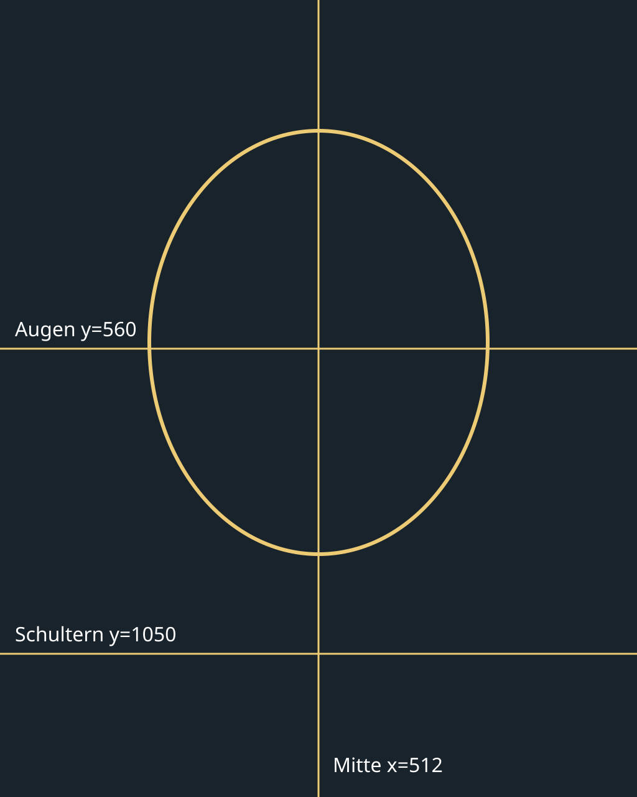
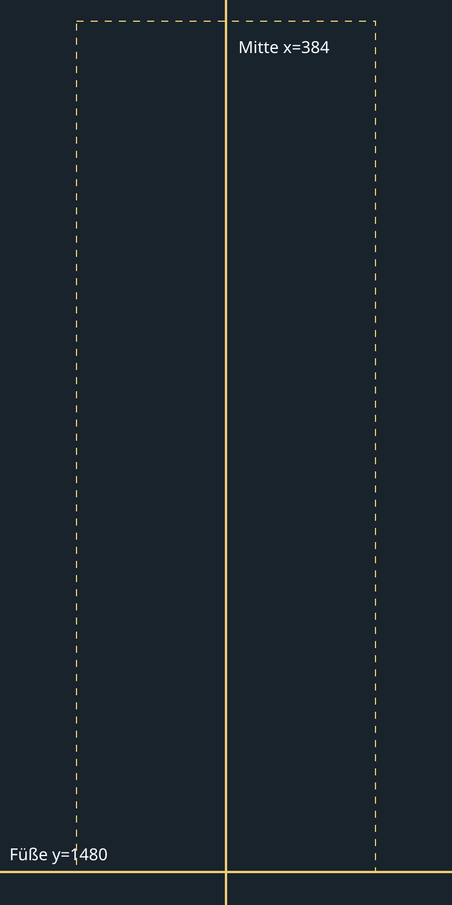

# Eigene Charakterbilder

Alle Figuren sind erwachsen. Beim Import sind ein Alter ab 18 und die Bestätigung erforderlich,
dass die Rechte am Bild vorliegen und abgebildete Personen erwachsen sind. Eine automatische
Alters- oder Gesichtserkennung gibt es nicht. Die Ausrichtung wird in der Führungsmaske manuell bestätigt.

**„Eigenes Bild verwenden“** ist Teil jedes Charaktereditors – schon in „Neues Spiel → Aussehen“
und beim Gestalten der zukünftigen Gefährtin, ohne laufendes Spiel. Porträt und Ganzkörperbild
werden getrennt hochgeladen, neu ausgerichtet, ersetzt oder entfernt; „Importierte Bilder“
übernimmt einen bereits gespeicherten Satz als eigene Kopie; „Standard wiederherstellen“ entfernt
beides. „Welches Bild benötige ich?“ erklärt Maße, Format, Perspektive, Licht und Ausrichtung mit
der Führungsmaske und bietet je eine kopierbare Vorlage für einen Bildgenerator.
Die **Charakterverwaltung** (früher „Eigene Charaktere“) ist im laufenden Spiel aus dem
Charaktereditor, den Personenansichten und über die bisherigen Porträt-Schaltflächen erreichbar. Die Android-Bildauswahl braucht
keine Speicherberechtigung. Auf älteren Android-Versionen nutzt AndroidX den verfügbaren System-Picker.

| | Porträt | Optionaler Ganzkörper |
|---|---|---|
| Import mindestens | 512 × 640 | 384 × 768 |
| Interne Ausgabe | 1024 × 1280 | 768 × 1536 |
| Ausrichtung | Mitte x=512, Augen y=560, Schultern y=1050 | Mitte x=384, Füße y=1480 |
| Dateityp | JPG, PNG, WebP, höchstens 15 MiB | PNG/WebP mit tatsächlich transparentem Hintergrund, höchstens 15 MiB |
| Verarbeitung | EXIF-Ausrichtung, sRGB, WebP q90 | ebenso; keine automatische Freistellung |

Mit zwei Fingern zoomen, drehen und verschieben; Knöpfe für Zoom, Vierteldrehung, Hilfslinien,
Rückgängig und Zurücksetzen. Bei Zoom 1 füllt ein Porträt den Rahmen, ein Ganzkörperbild passt
vollständig hinein (Kopf und Füße werden nicht abgeschnitten). Das Porträt muss alle Ecken
des Rahmens füllen („Rahmen füllen“ hilft). Augenlinie und Schultern an der Maske ausrichten. Ganzkörperbilder dürfen
transparente Ränder haben. Die Vorschau und die gespeicherte Datei verwenden dieselbe Transformation.

Bilder werden unter `filesDir/custom/{id}/portrait.webp` und/oder `fullbody.webp` gespeichert
(mindestens eines von beiden). Zusätzlich liegen dort eine auf höchstens 2560 px verkleinerte Kopie
des Originals (`original_portrait.webp`, `original_fullbody.webp`) und `meta.json` mit Herkunft und
letztem Zuschnitt – dadurch kann ein Bild später neu ausgerichtet werden. Das Original auf dem Gerät
darf danach gelöscht werden. Ersetzungen bekommen neue IDs, sodass bestehende
Backups nicht auf eine teilweise überschriebene Datei zeigen. Alte Content-URIs werden beim
Laden einmal in interne Dateien kopiert; unlesbare Originale werden verworfen und die
Bildschirme zeigen den Fallback. Import und Migration verwenden keine Cloud-Dienste.

Die Auflösung ist eigenes Bild → verfügbare fotorealistische Ebenen → prozedurale Zeichnung.
Ein Kopfrahmen schneidet immer das Fenster x=192, y=160, Breite=640, Höhe=800 aus dem Standardporträt aus.
Ohne Ganzkörperbild verwendet die Figur die mitgelieferten Fotolagen oder den prozeduralen Fallback. Ein stehendes eigenes Ganzkörperbild ist
kein animiertes Modell; es bleibt auch beim Gehen und Sitzen in seiner importierten Pose.

Der bisherige JSON-Spielstandexport enthält **keine Bilddateien**. Die Oberfläche weist darauf hin.
Das Kopieren einer JSON-Datei auf ein anderes Gerät sichert eigene Bilder daher nicht.

## Für Produktion und Prüfung

Produktionsliste und Prompt je Datei: [ASSET-PRODUCTION.md](ASSET-PRODUCTION.md).
Prüfung: `python3 -m pip install -r scripts/requirements-assets.txt`, dann `python3 scripts/check_assets`.
Der Standardaufruf schlägt bei fehlenden Bildern fehl. `--allow-missing` ist für ausdrücklich gewählte
Fallback-Builds vorgesehen; ungültige vorhandene Dateien bleiben dabei Fehler. Ein grüner Fallback-Build
behauptet daher nicht, dass ein Bildsatz fertig ist. `python3 scripts/make_asset_guides /tmp/troop-guides`
erzeugt alle Hilfsraster außerhalb der Laufzeit-Assets.
Die tatsächliche Motivregistrierung, Stilkonsistenz und Bildrechte erfordern eine zusätzliche Sichtprüfung.
